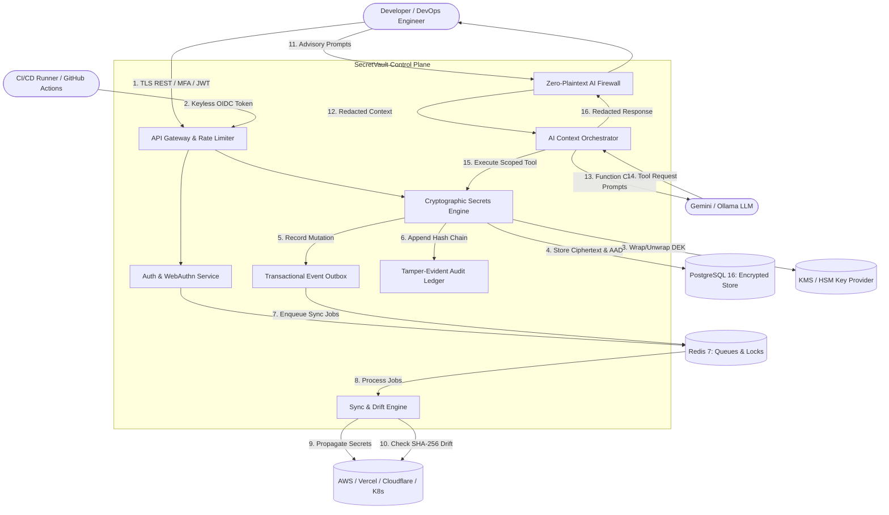
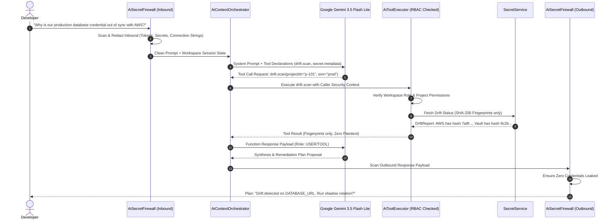
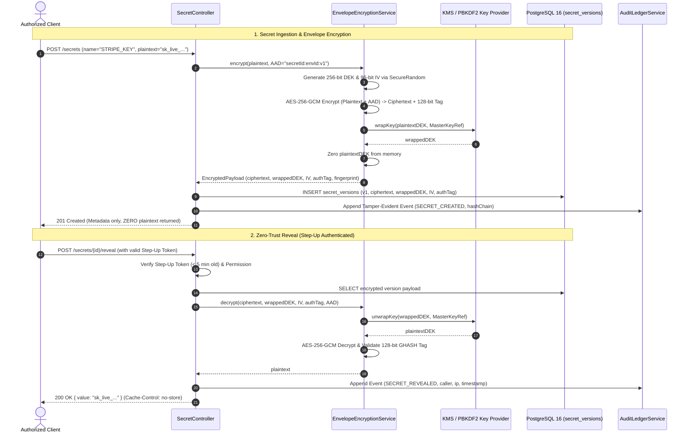
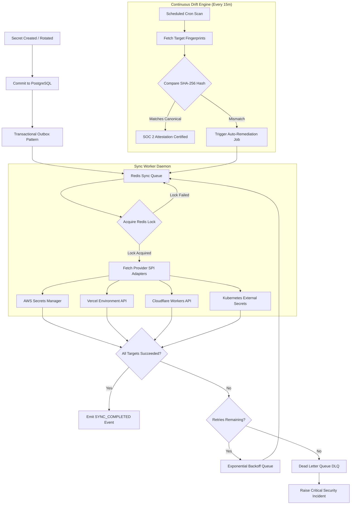

<div align="center">

# 🔐 SecretVault

### Enterprise DevSecOps Secrets Management Platform

[](https://openjdk.org/)
[](https://spring.io/projects/spring-boot)
[](https://react.dev/)
[](https://www.postgresql.org/)
[](https://redis.io/)
[](https://www.docker.com/)

**One control plane. Zero-trust encryption. Every secret. Every cloud.**

*A production-grade, zero-plaintext DevSecOps platform for managing, synchronizing, rotating, and auditing secrets across multi-cloud infrastructure — powered by an AI Security Copilot.*

</div>

---

## 📖 Table of Contents

- [What is SecretVault?](#-what-is-secretvault)
- [The Problem We Solve](#-the-problem-we-solve)
- [System Architecture](#-system-architecture)
- [Feature Deep Dive (F01 – F18)](#-feature-deep-dive-f01--f18)
  - [F01 · Authentication & Multi-Factor (MFA)](#f01--authentication--multi-factor-mfa)
  - [F02 · Workspace & Multi-Tenant Governance](#f02--workspace--multi-tenant-governance)
  - [F03 · Project & Environment Scoping](#f03--project--environment-scoping)
  - [F04 · Granular RBAC & Just-In-Time (JIT) Access](#f04--granular-rbac--just-in-time-jit-access)
  - [F05 · Cryptographic Secrets Engine (AES-256-GCM)](#f05--cryptographic-secrets-engine-aes-256-gcm)
  - [F06 · Zero-Trust Secret Reveal Protection](#f06--zero-trust-secret-reveal-protection)
  - [F07 · Automated Secret Rotation Engine](#f07--automated-secret-rotation-engine)
  - [F08 · Machine Identities & Keyless OIDC Federation](#f08--machine-identities--keyless-oidc-federation)
  - [F09 · Multi-Cloud Provider SPI Integrations](#f09--multi-cloud-provider-spi-integrations)
  - [F10 · Resilient Multi-Cloud Synchronization](#f10--resilient-multi-cloud-synchronization)
  - [F11 · Drift Detection & SOC 2 Continuous Attestation](#f11--drift-detection--soc-2-continuous-attestation)
  - [F12 · Event Center & Transactional Outbox](#f12--event-center--transactional-outbox)
  - [F13 · Automation Policy Engine & Loop Guard](#f13--automation-policy-engine--loop-guard)
  - [F14 · Webhook Platform & Anti-SSRF Dispatcher](#f14--webhook-platform--anti-ssrf-dispatcher)
  - [F15 · Security Incident Lifecycle Operations](#f15--security-incident-lifecycle-operations)
  - [F16 · Repository Leak Scanner & Git Hook Guard](#f16--repository-leak-scanner--git-hook-guard)
  - [F17 · Security Overview, Risk Center & Posture Score](#f17--security-overview--risk-center--posture-score)
  - [F18 · AI Security Copilot & DevSecOps Workbench](#f18--ai-security-copilot--devsecops-workbench)
- [Data Flow Diagrams (DFDs)](#-data-flow-diagrams-dfds)
- [Cryptographic Workflow & Envelope Encryption](#-cryptographic-workflow--envelope-encryption)
- [Multi-Cloud Sync & Auto-Remediation Pipeline](#-multi-cloud-sync--auto-remediation-pipeline)
- [Access Control Model & Hierarchical Scoping](#-access-control-model--hierarchical-scoping)
- [Technology Stack](#-technology-stack)
- [Project Directory Structure](#-project-directory-structure)
- [Getting Started & Local Development](#-getting-started--local-development)
- [API Reference](#-api-reference)
- [SDKs & Integrations](#-sdks--integrations)
- [Security Policy & Hardening Checklist](#-security-policy--hardening-checklist)
- [Contributing](#-contributing)

---

## 🚀 What is SecretVault?

**SecretVault** is an enterprise-grade **DevSecOps Secrets Management Control Plane** architected as a **Spring Boot 3 Modular Monolith (Java 21)** with:

- 🔒 **Zero-Trust AES-256-GCM Envelope Encryption** — every secret version is encrypted at rest using unique ephemeral Data Encryption Keys (DEKs) wrapped by KMS / PBKDF2 Master Key Encryption Keys (KEKs).
- 🌐 **Asynchronous Multi-Cloud Synchronization** — pushes secrets to AWS Secrets Manager, AWS SSM, Vercel, Cloudflare Workers, and Kubernetes External Secrets in real time.
- 🤖 **AI Security Copilot & Autonomous Remediation** — advisory DevSecOps copilot with a strict **Zero-Plaintext Firewall**, multi-step agentic tool calling, and Four-Eyes dual-custody verification.
- 📋 **Tamper-Evident SHA-256 Hash-Chained Audit Ledger** — cryptographic proof for SOC 2, ISO 27001, and HIPAA compliance requirements.
- 🛡️ **Comprehensive Operational Hardening** — WebAuthn FIDO2, TOTP RFC-6238, step-up MFA, Redis sliding-window fail-closed rate limiting, and full SSRF defense.

> SecretVault is built specifically for **application workloads and infrastructure credentials** — treating environments, versioning, drift detection, provider targets, and blast-radius telemetry as first-class primitives.

---

## 🔥 The Problem We Solve

Engineering teams routinely scatter identical credentials across `.env` files, staging environments, production cloud accounts, CI/CD runners, and developer laptops:

| Challenge | Real-World Failure Scenario | How SecretVault Solves It |
|---|---|---|
| **Secret Duplication** | Same DB credential pasted into 5 different dashboards; updates missed. | **Single Source of Truth:** Update once in SecretVault; automatically sync everywhere. |
| **Silent Drift** | Staging has v4 of an API key, while production has v5; deploys silently break. | **Continuous Drift Scanner:** Compares SHA-256 fingerprints across providers every 15 min. |
| **Leak Vulnerability** | Developers accidentally commit `.env` or tokens into Git repositories. | **Repository Leak Guard:** Scans PRs and commits using pattern recognition and Shannon entropy. |
| **High Blast Radius** | Compromised credentials take hours or days to identify, trace, and rotate. | **Blast Radius Graph & Instant Auto-Rotate:** Discovers all impacted workloads in seconds. |
| **Zero Auditability** | No logs showing who viewed credentials or which CI/CD runner read production secrets. | **Cryptographic Audit Ledger:** SHA-256 tamper-evident chain tracking every reveal and sync. |
| **Plaintext Leakage to AI** | Devs paste logs and credentials into cloud LLMs to troubleshoot outages. | **Zero-Plaintext AI Firewall:** Redacts credentials to `[SHA256:prefix]` before LLM processing. |

---

## 🏗️ System Architecture

```
┌────────────────────────────────────────────────────────────────────────────────────────────────────────┐
│                                       CLIENT & DEVELOPER SURFACE                                       │
│                                                                                                        │
│   ┌────────────────────┐   ┌─────────────────┐   ┌──────────────────┐   ┌──────────────────────────┐   │
│   │ React 18 Dashboard │   │ SecretVault CLI │   │ VS Code Extension│   │ Java / JS / Python SDKs  │   │
│   │ (Vite, Lazy views) │   │ (Picocli / M2M) │   │ (Direct IDE sync)│   │ (In-memory cached fetch) │   │
│   └─────────┬──────────┘   └────────┬────────┘   └────────┬─────────┘   └────────────┬─────────────┘   │
└─────────────┼───────────────────────┼─────────────────────┼──────────────────────────┼─────────────────┘
              │                       │                     │                          │
              └───────────────────────┴──────────┬──────────┴──────────────────────────┘
                                                 │ TLS 1.3 / mTLS / JWT Bearer Tokens
                                                 ▼
┌────────────────────────────────────────────────────────────────────────────────────────────────────────┐
│                             SPRING BOOT 3 CONTROL PLANE (Modular Monolith)                             │
│                                                                                                        │
│   ┌─────────────────────────┐  ┌──────────────────────────────────┐  ┌─────────────────────────────┐   │
│   │  SECURITY & GOVERNANCE  │  │   CRYPTOGRAPHIC SECRETS ENGINE   │  │    SYNC & DRIFT ENGINE      │   │
│   │  - BCrypt + WebAuthn    │  │   - AES-256-GCM Envelope Crypto  │  │    - Redis Async Queue & DLQ│   │
│   │  - TOTP MFA & Step-Up   │  │   - Ephemeral DEK / KMS KEK Wrap │  │    - Provider SPI Adapters  │   │
│   │  - Scoped RBAC + JIT    │  │   - AAD Context Binding          │  │    - SHA-256 Drift Scanning │   │
│   │  - Redis Rate Limiter   │  │   - Immutable Version Ledger     │  │    - Distributed Lock Safety│   │
│   └─────────────────────────┘  └──────────────────────────────────┘  └─────────────────────────────┘   │
│                                                                                                        │
│   ┌─────────────────────────┐  ┌──────────────────────────────────┐  ┌─────────────────────────────┐   │
│   │   EVENT & AUTOMATION    │  │   AUDIT & COMPLIANCE LEDGER      │  │   AI DEVSECOPS COPILOT      │   │
│   │  - Transactional Outbox │  │   - SHA-256 Merkle-Style Chain   │  │   - Inbound/Outbound Wall   │   │
│   │  - SSE / WS Broadcast   │  │   - Tamper-Evident Verification  │  │   - Multi-Step Tool Agent   │   │
│   │  - Policy Rules Engine  │  │   - SOC 2 / ISO 27001 Evidence   │  │   - Gemini 3.5 Flash / Ollama│  │
│   │  - Anti-SSRF Webhooks   │  │   - Non-Repudiation Logging      │  │   - Four-Eyes Gatekeeper    │   │
│   └─────────────────────────┘  └──────────────────────────────────┘  └─────────────────────────────┘   │
└────────────────────────────────────────────────┬───────────────────────────────────────────────────────┘
                                                 │
                        ┌────────────────────────┴────────────────────────┐
                        ▼                                                 ▼
      ┌───────────────────────────────────┐             ┌───────────────────────────────────┐
      │           PostgreSQL 16           │             │              Redis 7              │
      │  - Encrypted Secret Versions      │             │  - Distributed Mutual Exclusion   │
      │  - Workspaces, Projects, Envs     │             │  - Async Sync Queues & Retries    │
      │  - Tamper-Proof Audit Chain       │             │  - Sliding-Window Rate Limiting   │
      │  - Outbox Events & AI Memory      │             │  - Token Rotation Grace Windows   │
      └───────────────────────────────────┘             └───────────────────────────────────┘
                                                                          │
                                                                          ▼
                                                        ┌───────────────────────────────────┐
                                                        │       EXTERNAL CLOUD FABRIC       │
                                                        │  - AWS Secrets Manager / SSM      │
                                                        │  - Vercel Environment API         │
                                                        │  - Cloudflare Workers Secrets     │
                                                        │  - Kubernetes External Secrets CRD│
                                                        │  - GitHub Actions Secret Ingress  │
                                                        └───────────────────────────────────┘
```

---

## 🎯 Feature Deep Dive (F01 – F18)

### F01 · Authentication & Multi-Factor (MFA)
- **Primary Credentials:** BCrypt (`$2a$`, cost factor 12) password hashing with email verification.
- **Passkeys & Hardware Tokens:** WebAuthn FIDO2 attestation with anti-replay signature challenge counters.
- **Time-Based One-Time Passwords:** TOTP RFC-6238 compliant 6-digit verification with encrypted secret seeds.
- **Step-Up MFA Challenges:** High-impact operations (secret reveal, force rotation, deletion, AI high-risk executions) require a freshly minted Step-Up token (valid 5 minutes).
- **Concurrency-Safe OTP Delivery:** Uses in-place JPA `saveAndFlush` upsert patterns (`findByEmail` + update) to completely eliminate 409 conflict race conditions during rapid OTP re-sends.
- **Fail-Closed Rate Limiting:** Redis sliding-window limiter blocks brute-force authentication attacks (10 attempts/min per IP/email).

### F02 · Workspace & Multi-Tenant Governance
- **Strict Tenant Boundaries:** All database entities enforce foreign keys anchored directly to `workspace_id`.
- **Cryptographic Invitations:** 256-bit secure invitation tokens (`SecureRandom`) with strict 7-day TTL and email-locked acceptance validation.
- **Sole Owner Preservation Invariant:** The platform forbids workspace owners from downgrading or deleting the final remaining `OWNER` of a tenant.
- **Multi-Workspace Tenancy:** Users can switch workspaces instantaneously with isolated permission sets and distinct role scopes.

### F03 · Project & Environment Scoping
- **Hierarchical Containment:** Workspaces own Projects, and Projects own Environments (`development`, `staging`, `production`).
- **Path IDOR Elimination:** Every incoming request verifies that `Project.workspaceId == caller.workspaceId` and `Environment.projectId == caller.projectId`. Mismatched IDs return `404 RESOURCE_NOT_FOUND` to prevent IDOR enumeration.
- **Protected Environment Guards:** Production environments are marked `is_protected = true`, preventing direct mutations and requiring admin authorization or JIT access grants.

### F04 · Granular RBAC & Just-In-Time (JIT) Access
- **Mathematical Access Formula:**
  $$\text{Effective Permission} = \text{Workspace Role} \cap \text{Project Scope} \cap \text{Environment Scope} \cap \text{Security Guardrails}$$
- **Role Hierarchy:** `OWNER` > `ADMIN` > `DEVELOPER` > `VIEWER`. Child grants can restrict access, but can never elevate privileges above the workspace parent role.
- **JIT Elevation Lifecycle:** Developers can submit temporary elevation tickets (duration: 1 hour to 24 hours) with mandatory justification. Expired JIT grants are automatically revoked by background eviction jobs.

### F05 · Cryptographic Secrets Engine (AES-256-GCM)
- **Zero-Plaintext Memory Guarantee:** Plaintext secrets enter heap memory strictly during encryption/decryption execution and are never logged or stored in cache.
- **Envelope Encryption Protocol:**
  1. Generate unique 256-bit Data Encryption Key (DEK) and 96-bit Initialization Vector (IV) using `SecureRandom`.
  2. Encrypt plaintext payload with **AES-256-GCM** binding Authenticated Additional Data (`AAD = "secretId:envId:versionNumber"`).
  3. Wrap the DEK with KMS / PBKDF2 Master Key Encryption Key (KEK).
  4. Persist ciphertext, wrapped DEK, IV, 128-bit authentication tag, and SHA-256 content fingerprint.
- **Immutable Version History:** Updates generate sequential versions (`v1`, `v2`, ...). Zero-downtime rollback to any prior historical version is fully supported.

### F06 · Zero-Trust Secret Reveal Protection
- **Step-Up Verification Gate:** Decryption endpoints mandate recent Step-Up MFA authentication proof.
- **GHASH Tag Validation:** AES-GCM validates the 128-bit authentication tag; any ciphertext tampering triggers immediate payload rejection.
- **Audit Logging & Browser Defense:** Every reveal event writes caller identity, IP, user agent, and timestamp to the audit chain. Responses include `Cache-Control: no-store, no-cache, private` headers.

### F07 · Automated Secret Rotation Engine
- **Shadow Rollout Pattern:** Dual-credential workflow pushes new secret versions to targets before deactivating old versions, ensuring zero downtime for live services.
- **Blast Radius Analysis:** Computes which applications, microservices, machine tokens, and environments consume the secret prior to triggering rotation.
- **Grace Window Transition:** Old credentials remain valid during a configurable window (e.g., 15 minutes) before being permanently decommissioned.
- **Scheduled & Emergency Policies:** Supports scheduled cron intervals (30/60/90 days) and automated emergency rotations triggered by security incident alerts.

### F08 · Machine Identities & Keyless OIDC Federation
- **M2M Token Service:** Issues scoped, short-lived JWT machine tokens with 15-second rotation grace windows to prevent concurrent API renewal collisions.
- **Keyless OIDC Ingress:** Validates OIDC JWTs issued by GitHub Actions, GitLab CI, and Kubernetes Service Accounts against configured issuer, audience, and subject claims.
- **Zero Static Credentials:** Eliminates hardcoded long-lived API keys inside CI/CD runners by mapping verified OIDC claims directly to scoped workspace roles.

### F09 · Multi-Cloud Provider SPI Integrations
- **Pluggable Architecture:** The `SecretProvider` interface decouples the core domain from external cloud APIs:
  - **AWS Secrets Manager & SSM:** Native SDK v2 integration with KMS key mapping.
  - **Vercel:** Direct synchronization into project environment variables.
  - **Cloudflare Workers:** REST sync into Cloudflare encrypted script secrets.
  - **Kubernetes:** In-cluster and remote synchronization into `ExternalSecret` CRDs.
  - **GitHub Actions Secrets:** Syncs secrets into GitHub repository and organization secrets.

### F10 · Resilient Multi-Cloud Synchronization
- **Redis Queue Worker Pipeline:** Mutations enqueue background sync jobs processed asynchronously by worker daemons.
- **Exponential Backoff & Jitter:** Transient network or cloud provider outages retry automatically ($2^n$ second backoff, max 6 attempts).
- **Dead-Letter Queue (DLQ):** Exhausted jobs transfer to the DLQ, emitting notification alerts and preserving full failure payloads for manual replay.
- **Distributed Lock Mutual Exclusion:** Employs Redis `SETNX` distributed locking to ensure concurrent updates to identical secret-provider pairs never execute out of order.

### F11 · Drift Detection & SOC 2 Continuous Attestation
- **Fingerprint-Only Comparison:** Drift detection hashes provider-side values into SHA-256 fingerprints, eliminating the need to expose plaintext secrets during reconciliation.
- **Automated Drift Classification:** Categorizes discrepancies into `STALE` (provider lagging), `MODIFIED` (unauthorized out-of-band change), or `MISSING`.
- **Continuous Attestation:** Hourly automated audits certify synchronization state, exporting cryptographic compliance evidence formatted for SOC 2 Type II and ISO 27001 auditors.

### F12 · Event Center & Transactional Outbox
- **Transactional Outbox Guarantee:** Domain events are committed inside the exact same database transaction as the business entity changes, guaranteeing zero missed events.
- **Real-Time Client Streaming:** Outbox event dispatchers push updates to browser dashboards via Server-Sent Events (SSE) and WebSocket channels.
- **Event Replay Capability:** Administrators can replay specific event sequences from historical ledger checkpoints for auditing, testing, or system recovery.

### F13 · Automation Policy Engine & Loop Guard
- **Event-Driven Rules:** Configure automated triggers (e.g., `ON REPO_LEAK_DETECTED WHERE severity >= HIGH DO ROTATE_SECRET AND NOTIFY_TEAM`).
- **Infinite Loop Defense:** Tracks event causality chains and terminates cyclical triggers if identical rules fire more than 3 times within 60 seconds.
- **Four-Eyes Custody Requirement:** Destructive or high-impact actions (mass revocation, emergency provider detachment) require approvals from two distinct authorized administrators.

### F14 · Webhook Platform & Anti-SSRF Dispatcher
- **HMAC-SHA256 Payload Signing:** Outbound webhook payloads include `X-SecretVault-Signature: sha256={hmac}` signed with tenant-specific shared secrets.
- **Strict SSRF Mitigation:** All webhook target URLs are dynamically validated against DNS rebinding and internal network blocklists (`10.0.0.0/8`, `172.16.0.0/12`, `192.168.0.0/16`, `127.0.0.0/8`, `169.254.0.0/16`).
- **Resilient Delivery:** Implements retry exponential backoff with delivery logs, payload inspectors, and manual redelivery controls.

### F15 · Security Incident Lifecycle Operations
- **Full Operational Lifecycle:** Manages incidents from creation (`INC-####`) through `OPEN` → `INVESTIGATING` → `CONTAINED` → `RESOLVED` → `POST-MORTEM`.
- **Automated Containment Workflows:** One-click quarantine immediately suspends associated machine identities, isolates target environments, and queues secret rotations.
- **Cryptographic Audit Attachment:** Automatically attaches all relevant audit logs, affected secret versions, and telemetry snapshots directly to the incident record.

### F16 · Repository Leak Scanner & Git Hook Guard
- **Multi-Engine Detection:** Evaluates Git repositories using regex pattern recognition, provider signatures (AWS, Stripe, GitHub, Slack), and **Shannon Entropy** analysis (> 4.5 bits/char).
- **GitHub Push Webhook Scanning:** Ingests repository push events via webhooks, downloads repository archives with HTTP fallback mechanisms, and executes scans within isolated sandboxes.
- **Context-Aware Noise Suppression:** Evaluates surrounding code syntax and test-fixture allowlists to prevent false alarms on mock credentials.

### F17 · Security Overview, Risk Center & Posture Score
- **Dynamic Posture Scoring (0–100):** Real-time algorithm calculates workspace health based on secret age, encryption strength, MFA adoption, unresolved drift, and leak findings.
- **Visual Blast Radius Heatmaps:** Displays an interactive dependency matrix illustrating which services, projects, and environments depend on each secret.
- **Access Certification Reviews:** Provides security officers with scheduled quarterly access review workflows to certify team permissions.

### F18 · AI Security Copilot & DevSecOps Workbench
- **Strict Zero-Plaintext Firewall (`AiSecretFirewall`):** Dual-pass filter scans inbound questions, tool parameters, tool outputs, and LLM responses, stripping and redacting credentials into `[SHA256:prefix]` hashes.
- **Server-Side RBAC Tool Invocation:** The AI model autonomously selects domain tools (`secrets.summary`, `rotation.schedule`, `drift.scan`, `user.getCurrent`), with each call validated server-side against caller permissions.
- **Multi-Turn Agentic Reasoning:** `AiContextOrchestrator` executes bounded multi-turn tool calling (max 5 iterations, max 10 tool calls) with cycle detection.
- **Pluggable LLM Providers:** Supports **Google Gemini 3.5 Flash Lite** (primary cloud reasoning), **Ollama** (air-gapped local execution), and an **Offline Provider** for CI/CD environments.
- **Four-Eyes & Step-Up Guardrail:** High-risk actions proposed by the AI generate structured remediation plans requiring Step-Up MFA and dual-custody approval before execution.

---

## 📊 Data Flow Diagrams (DFDs)

### Level 1: System-Wide Data Flow



### Level 2: AI Security Copilot & Zero-Plaintext Boundary



---

## 🔐 Cryptographic Workflow & Envelope Encryption

SecretVault utilizes multi-layered envelope encryption designed to meet **NIST SP 800-57** standards:



---

## ☁️ Multi-Cloud Sync & Auto-Remediation Pipeline



---

## 🛡️ Access Control Model & Hierarchical Scoping

Access is strictly evaluated through hierarchical containment, ensuring zero privilege escalation:

```
🏢 Organization Tenant Root
└── 📁 Workspace (Hard Isolation Boundary)
    ├── 👥 Members: [alice: OWNER], [bob: ADMIN], [carol: DEVELOPER], [dave: VIEWER]
    │
    ├── 📦 Project: "payment-gateway"
    │   ├── 🌿 Environment: development   [Protected: false] -> Access: DEVELOPER+
    │   ├── 🌿 Environment: staging       [Protected: false] -> Access: DEVELOPER+
    │   └── 🌿 Environment: production    [Protected: TRUE]  -> Access: ADMIN or JIT
    │
    ├── 🤖 Machine Identities
    │   ├── github-actions-runner   [OIDC Federated: repo:my-org/payment-gateway]
    │   └── k8s-production-service  [M2M Token: 15-min TTL, rotation grace]
    │
    └── 🔗 Provider Mappings
        ├── AWS Secrets Manager (us-east-1)
        └── Vercel (Production)
```

### Effective Role & Permission Matrix

| Capability | OWNER | ADMIN | DEVELOPER | VIEWER | JIT ELEVATED |
|---|:---:|:---:|:---:|:---:|:---:|
| **Manage Billing & Workspace Deletion** | ✅ | ❌ | ❌ | ❌ | ❌ |
| **Invite & Manage Team Members** | ✅ | ✅ | ❌ | ❌ | ❌ |
| **Create / Update Secrets (Dev / Staging)** | ✅ | ✅ | ✅ | ❌ | ✅ |
| **Mutate Secrets (Production)** | ✅ | ✅ | ❌ | ❌ | ✅ |
| **Reveal Secret Plaintext** | ✅ *(Step-Up)* | ✅ *(Step-Up)* | ❌ | ❌ | ✅ *(Step-Up)* |
| **Configure Provider Integrations** | ✅ | ✅ | ❌ | ❌ | ❌ |
| **Trigger Drift Scans & Sync** | ✅ | ✅ | ✅ | ❌ | ✅ |
| **View Audit Logs & Posture Dashboard** | ✅ | ✅ | ✅ | ✅ | ✅ |
| **Execute High-Risk AI Remediation Plans** | ✅ *(Four-Eyes)* | ✅ *(Four-Eyes)*| ❌ | ❌ | ❌ |

---

## 🛠️ Technology Stack

| Layer | Component | Version | Rationale & Responsibility |
|---|---|---|---|
| **Backend Runtime** | Java OpenJDK | 21 (LTS) | Virtual Threads (Project Loom), Records, Pattern Matching |
| **Framework** | Spring Boot | 3.3.x | Modular monolith architecture, Spring Security 6, Data JPA |
| **Frontend UI** | React | 18.x | Vite bundler, route code splitting (`React.lazy`), Suspense |
| **Primary Database** | PostgreSQL | 16.x | Relational store, encrypted secret versions, Flyway migrations |
| **Cache & Queues** | Redis | 7.x | Sliding-window rate limiters, distributed locks, sync queues |
| **Cryptography** | JCA / JCE / AWS KMS | AES-256-GCM | Hardware-grade envelope encryption with AAD binding |
| **Database Migrations** | Flyway | 10.x | Version-controlled, reproducible database schema (V1 – V22+) |
| **CLI Client** | Picocli | 4.x | Native terminal CLI (`secretvault run`, `inject`, `ai`) |
| **AI Cloud Provider** | Google Gemini | 3.5 Flash Lite | High-speed, context-aware DevSecOps copilot reasoning |
| **AI Local Provider** | Ollama | Latest | Local, privacy-first, air-gapped LLM reasoning |
| **Containerization** | Docker Compose | v2 | One-click local development stack |
| **Orchestration** | Kubernetes & Helm | 1.28+ | High-availability production cloud deployments |
| **Infrastructure as Code**| Terraform | 1.5+ | AWS infrastructure, KMS keys, and RDS provisioning |

---

## 📂 Project Directory Structure

```
SecureVault/
├── 📁 backend/                          # Spring Boot 3 Modular Monolith (Java 21)
│   └── src/main/java/com/secretvault/
│       ├── ai/                          # AI Copilot: Orchestrator, Firewall, Tools, Providers
│       ├── audit/                       # Tamper-Evident SHA-256 Audit Ledger & SOC 2 Exporter
│       ├── auth/                        # JWT, WebAuthn FIDO2, TOTP, Step-Up MFA, Registration
│       ├── automation/                  # Automation Rules Engine, Loop Guard, Actions
│       ├── common/                      # Exception Handlers, Redis Rate Limiting, Caching
│       ├── encryption/                  # AES-256-GCM Envelope Encryption Engine & KMS SPI
│       ├── environment/                 # Environment Scoping & Protection Policies
│       ├── incident/                    # Security Incident Lifecycle (INC-####)
│       ├── machine/                     # Machine Identities, Service Accounts & OIDC Trust
│       ├── project/                     # Project Containers & Scoped RBAC Permissions
│       ├── provider/                    # Cloud Provider SPI Adapters (AWS, Vercel, CF, K8s)
│       ├── repository/                  # Git Repo Scanner, Leak Detector & Webhook Ingress
│       ├── secret/                      # Secret Core: CRUD, Versioning, Rollbacks, Reveals
│       ├── security/                    # Risk Center, Posture Score & Blast Radius Engine
│       ├── sync/                        # Redis Queue Daemon, Drift Detector & Dead-Letter Queue
│       ├── webhook/                     # HMAC-SHA256 Webhook Dispatcher & SSRF Defense
│       └── workspace/                   # Multi-Tenant Workspace & Member Governance
│
├── 📁 frontend/                         # React 18 SPA (Vite + TailwindCSS)
│   └── src/
│       ├── api/                         # Typed API client services
│       ├── components/
│       │   ├── ai/                      # AI Copilot & Remediation Workbench Views
│       │   ├── audit/                   # Audit Logs Explorer & Verification Views
│       │   ├── auth/                    # Login, MFA Setup & Step-Up Modals
│       │   ├── risk/                    # Risk Center, Heatmaps & Blast Radius Views
│       │   ├── security/                # Security Overview & Posture Dashboards
│       │   ├── settings/                # Provider Integrations & GitHub Config Views
│       │   └── workspace/               # Workspaces, Projects & Secrets Overview
│       └── services/                    # Client-side state & notification services
│
├── 📁 cli/                              # SecretVault CLI (Picocli Java 21)
│   └── src/main/java/com/secretvault/cli/command/
│       ├── AiCommand.java               # Interactive AI DevSecOps CLI terminal
│       ├── RunCommand.java              # secretvault run (injects secrets into child process)
│       └── SecretsCommand.java          # CLI secret management commands
│
├── 📁 sdk/                              # Multi-Language Client SDKs
│   ├── secretvault-sdk-core/            # Java Spring Boot Starter SDK
│   ├── secretvault-sdk-js/              # TypeScript / Node.js Client SDK
│   └── secretvault-sdk-python/          # Python 3 Client SDK
│
├── 📁 infrastructure/                   # Deployment & Cloud Automation
│   ├── kubernetes/                      # Helm chart configurations
│   └── terraform/                       # AWS IaC modules
│
├── 📁 docs/                             # Comprehensive Technical Documentation
│   ├── WORKFLOW_ARCHITECTURE.md         # Full architecture specification
│   ├── COMPLETE_FEATURE_DATA_FLOW_ARCHITECTURES.md # Level 1 & 2 DFD specifications
│   ├── images/                          # High-resolution architectural flow diagrams
│   └── phase15/                         # AI Copilot platform specifications
│
├── 📁 vscode-extension/                 # Official VS Code Extension
├── 🐳 docker-compose.yml                # Multi-container local stack (App, DB, Redis)
├── 🔒 .env.example                      # Production environment configuration template
└── 📋 CHANGELOG.md                      # Release notes & version milestones
```

---

## 🚀 Getting Started & Local Development

### Prerequisites

- **Java Development Kit (JDK):** Version 21 (Eclipse Temurin or OpenJDK recommended)
- **Node.js:** Version 20.x or later with `npm`
- **Docker & Docker Compose:** Version 24+
- **Git**

### 1. Clone & Setup Workspace

```bash
git clone https://github.com/Hrushi4151/SecretVault.git
cd SecretVault
cp .env.example .env
```

### 2. Configure Local Environment (`.env`)

```env
# Application Database
DB_URL=jdbc:postgresql://localhost:5432/secretvault
DB_USERNAME=secretvault
DB_PASSWORD=secretvault_dev_password

# Redis Cache & Sync Queues
REDIS_URL=redis://localhost:6379

# JWT Security
JWT_SECRET=super_secret_jwt_signing_key_at_least_256_bits_long_for_security_12345
JWT_ACCESS_TTL_SECONDS=900
JWT_REFRESH_TTL_SECONDS=604800

# Envelope Master Key Derivation (PBKDF2 mode for local dev)
ENCRYPTION_PROVIDER=PBKDF2
ENCRYPTION_MASTER_PASSWORD=my_ultra_secure_local_master_kek_passphrase

# Optional: Google Gemini AI Copilot
GEMINI_API_KEY=your_gemini_api_key_here
```

### 3. Spin Up Infrastructure (PostgreSQL 16 & Redis 7)

```bash
docker-compose up -d postgres redis
```

### 4. Launch Backend Control Plane

```bash
cd backend
./mvnw clean spring-boot:run
```
*Backend initializes Flyway database migrations (V1 – V22) and starts listening on `http://localhost:3000`.*

### 5. Launch React Frontend Dashboard

```bash
cd ../frontend
npm install
npm run dev
```
*Frontend opens at `http://localhost:5173` with full hot-module replacement (HMR).*

---

## 📡 API Reference

All REST endpoints reside under the `/api/v1` namespace:

### Authentication & Sessions
| Method | Endpoint | Description |
|---|---|---|
| `POST` | `/api/v1/auth/register/send-otp` | Request email verification OTP |
| `POST` | `/api/v1/auth/register/verify-otp` | Verify OTP and bootstrap account |
| `POST` | `/api/v1/auth/login` | Authenticate with email and password |
| `POST` | `/api/v1/auth/refresh` | Renew expiring access token via refresh token |
| `POST` | `/api/v1/auth/step-up` | Complete Step-Up challenge for sensitive actions |

### Secrets Engine
| Method | Endpoint | Description |
|---|---|---|
| `GET` | `/api/v1/workspaces/{wId}/projects/{pId}/environments/{eId}/secrets` | List secret metadata in environment |
| `POST` | `/api/v1/workspaces/{wId}/projects/{pId}/environments/{eId}/secrets` | Ingest new encrypted secret version |
| `GET` | `/api/v1/.../secrets/{id}` | Retrieve secret metadata & version list |
| `PUT` | `/api/v1/.../secrets/{id}` | Push updated version (envelope encrypted) |
| `DELETE` | `/api/v1/.../secrets/{id}` | Permanently delete secret & historical versions|
| `POST` | `/api/v1/.../secrets/{id}/reveal` | Decrypt and reveal plaintext *(Step-Up MFA required)*|
| `POST` | `/api/v1/.../secrets/{id}/rotate` | Trigger immediate rotation workflow |

### Multi-Cloud Sync & Drift
| Method | Endpoint | Description |
|---|---|---|
| `POST` | `/api/v1/workspaces/{wId}/sync/trigger` | Trigger immediate multi-cloud synchronization |
| `GET` | `/api/v1/workspaces/{wId}/sync/status` | Retrieve status of active and recent sync jobs |
| `POST` | `/api/v1/workspaces/{wId}/sync/drift-scan` | Execute live SHA-256 drift detection scan |

### AI Security Copilot
| Method | Endpoint | Description |
|---|---|---|
| `POST` | `/api/v1/workspaces/{wId}/ai/chat` | Send advisory query to AI Copilot |
| `POST` | `/api/v1/workspaces/{wId}/ai/chat/stream` | Stream real-time AI responses via SSE |
| `GET` | `/api/v1/workspaces/{wId}/ai/conversations` | Retrieve multi-turn chat history |
| `POST` | `/api/v1/workspaces/{wId}/ai/remediation/execute`| Execute approved remediation plan *(Four-Eyes)*|

### Audit & Compliance
| Method | Endpoint | Description |
|---|---|---|
| `GET` | `/api/v1/workspaces/{wId}/audit-logs` | Paginated immutable audit ledger events |
| `GET` | `/api/v1/workspaces/{wId}/audit-logs/export`| Export SOC 2 / ISO 27001 compliance audit trail |

---

## 📦 SDKs & Integrations

### Java Spring Boot Integration
Add the dependency to your `pom.xml`:
```xml
<dependency>
    <groupId>io.secretvault</groupId>
    <artifactId>secretvault-sdk-core</artifactId>
    <version>1.5.0</version>
</dependency>
```
Inject secrets seamlessly in your configuration:
```java
@Configuration
public class DatabaseConfig {
    @Autowired
    private SecretVaultClient secretVault;

    @Bean
    public DataSource dataSource() {
        String dbUrl = secretVault.getSecret("DATABASE_URL", "production");
        return DataSourceBuilder.create().url(dbUrl).build();
    }
}
```

### Node.js / TypeScript SDK
```typescript
import { SecretVaultClient } from '@secretvault/sdk';

const client = new SecretVaultClient({
  baseUrl: 'https://vault.company.internal',
  machineToken: process.env.SECRETVAULT_TOKEN,
  cacheTtlMs: 300_000, // 5-minute in-memory caching
});

const apiKey = await client.getSecret('STRIPE_API_KEY', {
  workspaceId: 'ws-prod-01',
  environment: 'production'
});
```

### Python SDK
```python
from secretvault import SecretVaultClient

client = SecretVaultClient(
    base_url="https://vault.company.internal",
    token=os.getenv("SECRETVAULT_TOKEN")
)

db_password = client.get_secret(
    name="DB_PASSWORD",
    workspace_id="ws-prod-01",
    environment="production"
)
```

### SecretVault CLI (`secretvault run`)
Safely inject secrets into applications without writing credentials to disk or `.env` files:
```bash
# Injects decrypted secrets directly into child process environment
secretvault run --workspace ws-prod-01 --project api --env production -- node server.js
```

---

## 🔒 Security Policy & Hardening Checklist

SecretVault is designed to defend against advanced adversarial attacks. Our security posture includes:

- [x] **Zero-Plaintext at Rest:** AES-256-GCM envelope encryption with unique ephemeral DEKs.
- [x] **Zero-Plaintext in AI Workflows:** Complete redaction of credentials by `AiSecretFirewall`.
- [x] **Zero-Knowledge Drift Scans:** Comparison performed via SHA-256 fingerprints without exposing plaintext values.
- [x] **Anti-Tamper Audit Trail:** SHA-256 cryptographic hash-chaining prevents audit record alteration.
- [x] **IDOR-Proof Hierarchy:** Every request validates workspace, project, and environment ownership.
- [x] **SSRF Defense:** Webhooks and cloud provider integrations validate destination IPs against private CIDR blocklists and DNS rebinding attacks.
- [x] **Four-Eyes Separation of Duties:** High-risk actions require dual-custody authorization (`Approver A != Approver B`).
- [x] **Fail-Closed Rate Limiting:** Redis rate limits fail closed during cache partitions.

### Reporting Security Vulnerabilities

If you discover a security vulnerability within SecretVault, **please do NOT open a public GitHub issue.** Instead, send a detailed disclosure report directly to our security response team:

📧 **security@secretvault.io**

Please include:
1. Description of the vulnerability and attack vector.
2. Step-by-step reproduction steps or proof-of-concept (PoC).
3. Potential impact and affected components.

We acknowledge reports within **24 hours** and aim to release patches for confirmed critical vulnerabilities within **72 hours**.

---

## 🤝 Contributing

We welcome contributions from the open-source community!

1. Fork the repository on GitHub.
2. Create your feature branch: `git checkout -b feat/my-new-feature`
3. Commit your changes following [Conventional Commits](https://www.conventionalcommits.org/):
   ```bash
   git commit -m "feat(sync): add support for Azure Key Vault provider"
   ```
4. Ensure all tests pass:
   ```bash
   cd backend && ./mvnw test
   ```
5. Push to your branch and open a Pull Request against `main`.

---

<div align="center">

**Built with ❤️ for DevSecOps, Cloud Engineers, and Security Teams**

[](https://github.com/Hrushi4151/SecretVault)
[](https://opensource.org/licenses/MIT)

</div>
