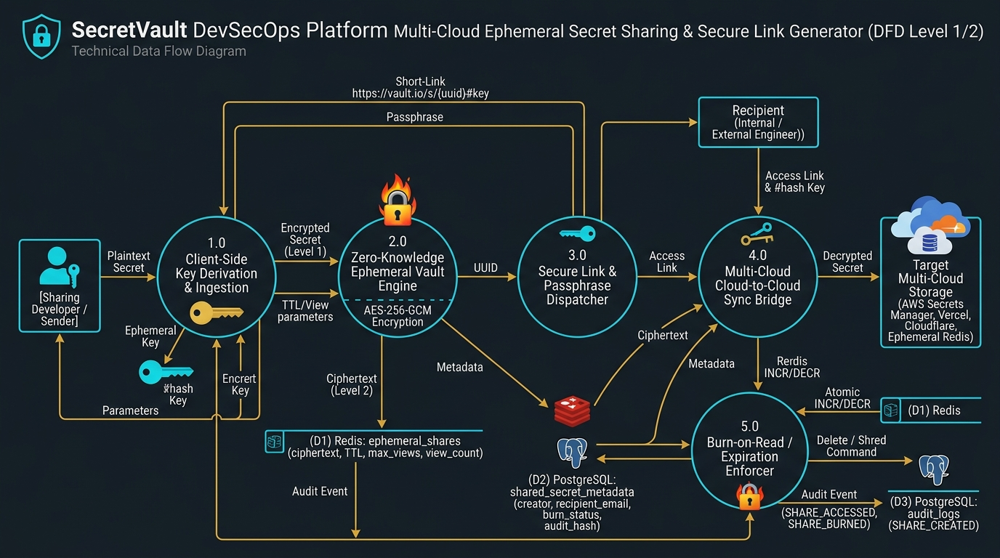
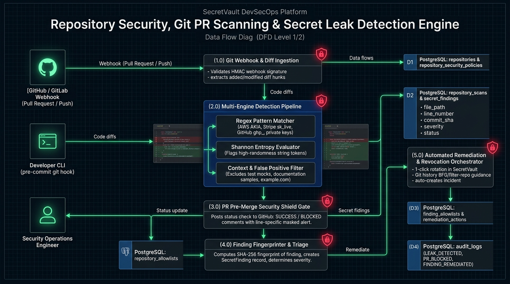
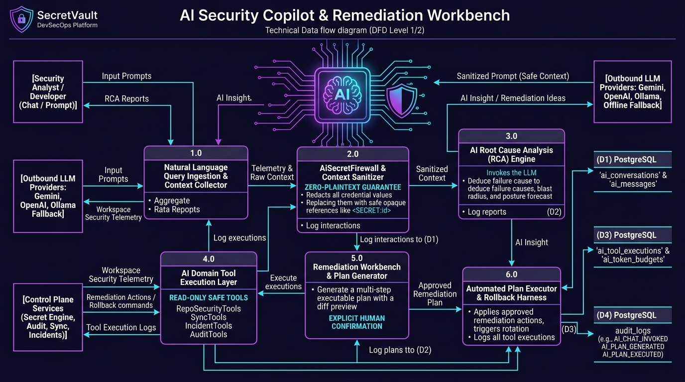
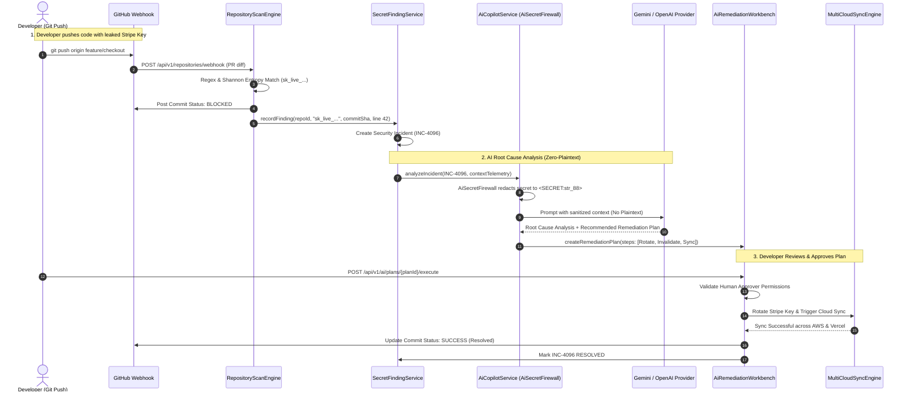

# SecretVault — Advanced Data Flow Architectures: Multi-Cloud Sharing, Repo Leak Detection & AI Copilot

> This document specifies the architectures and **Data Flow Diagrams (DFD Level 1/2)** for three of SecretVault's most critical advanced capabilities:
> 1. **Multi-Cloud Ephemeral Secret Sharing & Secure Link Generator**
> 2. **Repository Security, Pre-Merge PR Scanning & Secret Leak Detection**
> 3. **AI Security Copilot & Remediation Workbench**

---

## 1. Feature Deep-Dive: Multi-Cloud Ephemeral Secret Sharing & Secure Link Generator

This capability allows developers and automated pipelines to share sensitive credentials with external engineers or cross-cloud destinations with zero-knowledge encryption, burn-on-read mechanics, and strict time-to-live expiration.

### A. Architectural Invariants & Data Flow Steps
1. **Client-Side Key Derivation (Level 1 Encryption):**
   - The browser or CLI generates an ephemeral 256-bit AES-GCM key in memory.
   - The plaintext is encrypted locally before transmission. The key is appended to the URL fragment (`https://vault.io/s/{uuid}#key`).
   - *Zero-Knowledge Guarantee:* The URL fragment `#key` is **never** transmitted over HTTP to SecretVault servers.
2. **Server-Side Ephemeral Vault Engine (Level 2 Encryption):**
   - The server wraps the already-encrypted payload with a second layer of AES-256-GCM.
   - Binds caller metadata, access passphrase (optional argon2id hash), max views ($1$), and expiration TTL ($1\text{ hour} - 7\text{ days}$).
3. **Multi-Cloud Cloud-to-Cloud Sync Bridge:**
   - Enables direct push of the shared credential into recipient cloud environments (AWS Secrets Manager, Vercel, Cloudflare Workers).
4. **Burn-on-Read / Expiration Enforcer:**
   - Redis atomic `DECR` counter evaluates view counts.
   - Upon first retrieval (or expiration), Redis immediately shreds the ciphertext key. Memory and disks retain zero traces.

---

## 2. Feature Deep-Dive: Repository Security, Git PR Scanning & Secret Leak Detection

Protects GitHub, GitLab, and local developer workstations from accidental secret commits and leaks via pre-merge gates, entropy analysis, and automated remediation.

### A. Architectural Invariants & Data Flow Steps
1. **Git Webhook & Diff Ingestion (Process 1.0):**
   - Receives pull request and commit push events from GitHub/GitLab.
   - Verifies webhook HMAC signature (`X-Hub-Signature-256`).
   - Extracts only added/modified line diffs (ignores unchanged files).
2. **Multi-Engine Detection Pipeline (Process 2.0):**
   - **Regex Pattern Engine:** Matches against curated rule sets (AWS AKIA, Stripe `sk_live_`, GitHub `ghp_`, RSA private keys, Slack bot tokens).
   - **Shannon Entropy Evaluator:** Evaluates token character randomness:
     $$H(X) = -\sum_{i=1}^{n} P(x_i) \log_2 P(x_i)$$
     Strings with entropy above policy threshold ($H > 4.5$) trigger high-entropy alerts.
   - **Context & False-Positive Filter:** Automatically ignores test mock directories (`__tests__`, `testdata/`), dummy domains (`example.com`), and allowed hashes.
3. **PR Pre-Merge Security Shield Gate (Process 3.0):**
   - Posts a GitHub commit status check: `BLOCKED (1 Secret Leak Detected)`.
   - Posts a PR comment displaying the file and line number with the matched secret value **masked** (`AKIA************4F`).
4. **Finding Fingerprinter & Triage (Process 4.0):**
   - Generates a deterministic SHA-256 finding fingerprint: `SHA256(repoId:filePath:ruleId:normalizedPattern)`.
   - Prevents duplicate findings across subsequent commits.
5. **Automated Remediation & Revocation (Process 5.0):**
   - Offers 1-click credential rotation in SecretVault.
   - Emits step-by-step instructions for rewriting Git history using `git-filter-repo` / BFG Repo-Cleaner.

---

## 3. Feature Deep-Dive: AI Security Copilot & Remediation Workbench

An AI-driven threat analysis and automated remediation engine powered by multi-provider LLM integrations (Gemini, OpenAI, Ollama, and Deterministic Offline Fallback) with a strict zero-plaintext security firewall.

### A. Architectural Invariants & Data Flow Steps
1. **Zero-Plaintext AI Firewall (`AiSecretFirewall` & `AiContextSanitizer`):**
   - **Zero Plaintext Rule:** The firewall intercepts every outgoing payload.
   - All secret names, values, private keys, and sensitive tokens are stripped and replaced with opaque reference tokens: `<SECRET:uuid>`.
   - The external LLM **never** sees or processes plaintext credentials.
2. **Context Telemetry Aggregator (Process 1.0):**
   - Aggregates workspace security telemetry: active incidents (`INC-####`), provider drift states, failed sync jobs, and audit event streams.
3. **AI Root Cause Analysis (RCA) Engine (Process 3.0):**
   - Diagnoses why a deployment failed, why drift occurred, or how a compromised credential affects the platform.
   - Deduces blast radius impact and posture forecasts.
4. **AI Domain Tool Execution Layer (Process 4.0):**
   - AI agent executes read-only domain tools via structured tool-calls:
     `RepoSecurityTools`, `SyncTools`, `IncidentTools`, `AuditTools`, `AccessTools`.
5. **Remediation Workbench & Human-in-the-Loop Plan Generator (Process 5.0 & 6.0):**
   - Formulates a structured, multi-step remediation plan with diff previews (e.g., Step 1: Revoke GitHub token; Step 2: Provision new key; Step 3: Trigger sync to Vercel).
   - **Human Confirmation Gate:** Requires explicit developer approval before any write or destructive action executes.
   - Supports automated rollback if any step fails.

---

## 4. End-to-End Sequence Diagram: Repository Leak to AI Remediation

---

## 5. Persistence Stores & Schema Mapping

| Data Store | Entity / Table | Responsibilities |
|---|---|---|
| **Redis** | `ephemeral_shares` | Holds dual-encrypted shared secrets with TTL and atomic view counter (`max_views = 1`). |
| **PostgreSQL** | `repository_scans` | Logs Git scan runs, commit hashes, branch names, and scanner runtimes. |
| **PostgreSQL** | `secret_findings` | Stores detected secret fingerprints, file paths, line numbers, and triage states. |
| **PostgreSQL** | `finding_allowlists` | Rules for ignoring approved false positives, test fixtures, and documentation strings. |
| **PostgreSQL** | `ai_conversations` & `ai_messages` | Full history of AI chat sessions and advisory interactions. |
| **PostgreSQL** | `ai_rca_reports` | Persisted Root Cause Analysis reports with blast radius metrics and telemetry evidence. |
| **PostgreSQL** | `ai_remediation_plans` | Multi-step actionable remediation plans with execution ledger and rollback state. |
| **PostgreSQL** | `ai_token_budgets` | Workspace-level token consumption limits to prevent cost overruns. |
| **PostgreSQL** | `audit_logs` | Immutable audit ledger tracking all sharing, leak discoveries, and AI tool executions. |
