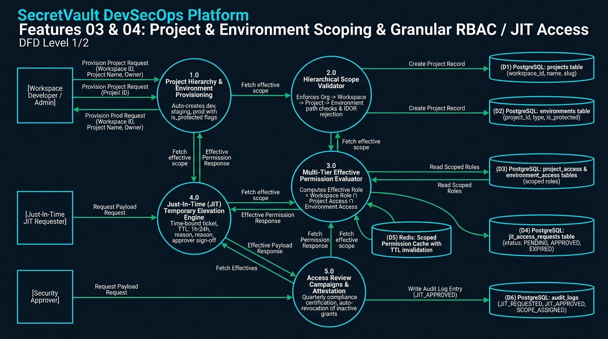
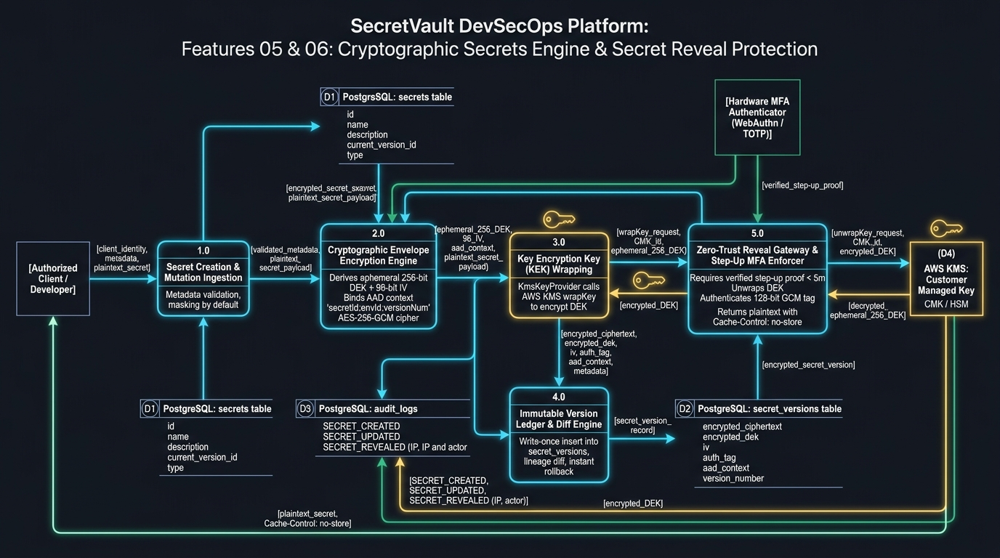
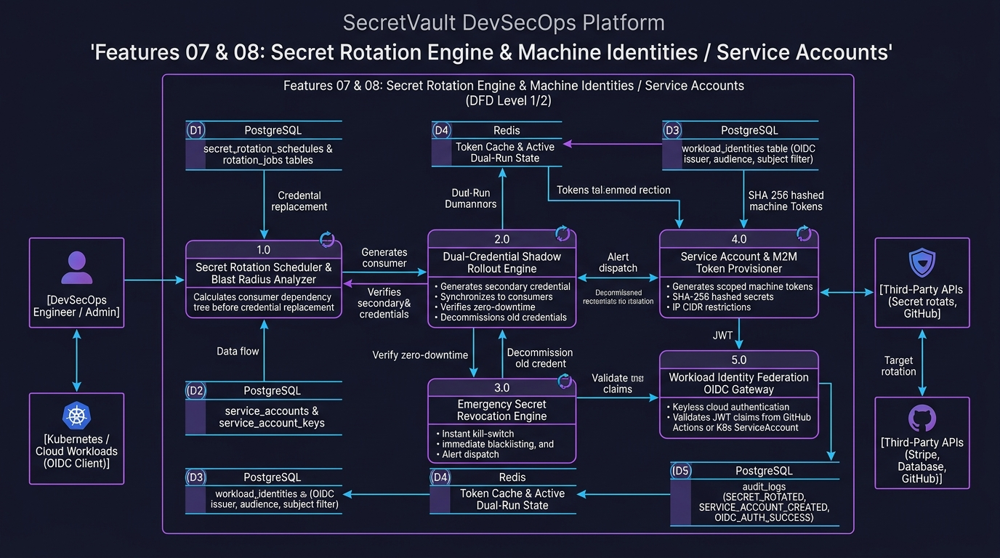
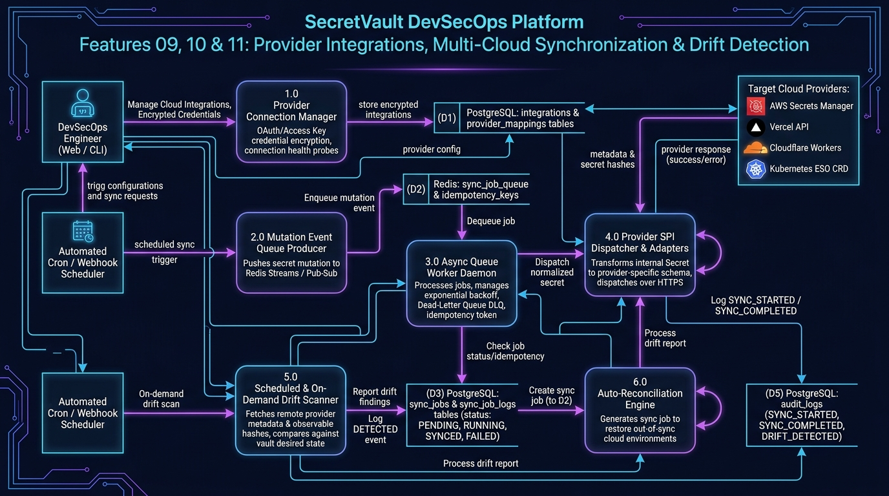
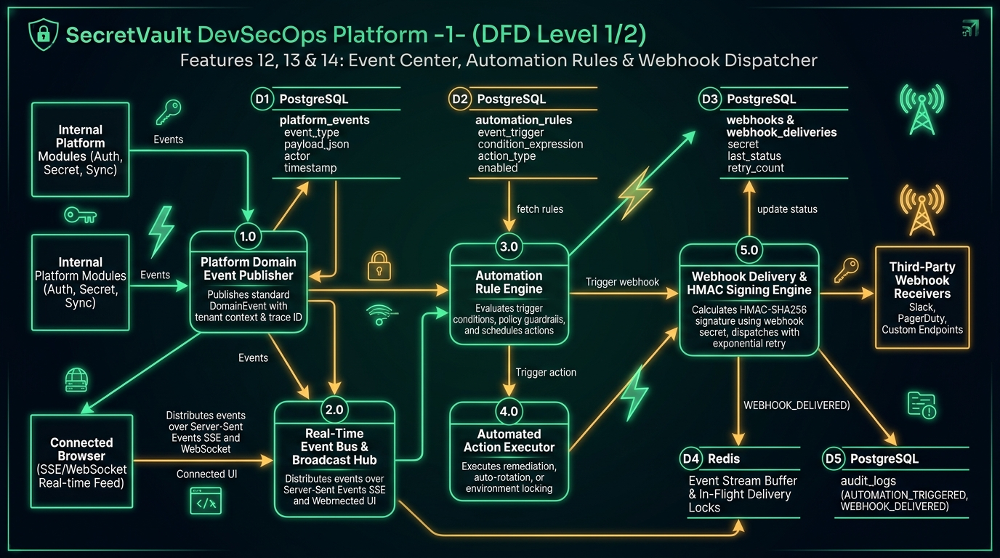
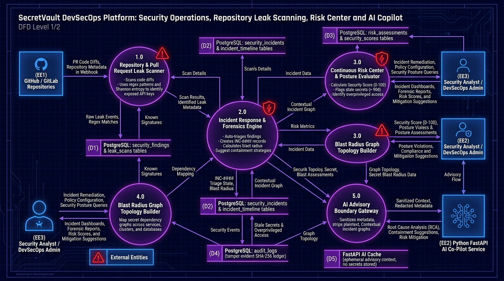

# SecretVault — Complete Feature Data Flow Architectures (F01 – F18)

> This compendium provides the definitive technical specification and **Data Flow Diagrams (DFD Level 1/2)** for all **18 core features** of the **SecretVault DevSecOps Platform**. Each architecture outlines external entities, central processes, data stores, sequence flows, and core security invariants.

---

## 1. Feature Map & Architecture Index

| Cluster | Feature Group | Primary Modules & Components |
|---|---|---|
| **Cluster 1** | **[F01] Authentication & Onboarding** **[F02] Workspace & Tenant Management** | WebAuthn/TOTP, Org Bootstrap, Session tokens, Rate limiting, Invitations |
| **Cluster 2** | **[F03] Project & Environment Scoping** **[F04] Granular RBAC & JIT Access** | Path IDOR prevention, Dev/Staging/Prod protection, Effective role formula, JIT tickets |
| **Cluster 3** | **[F05] Cryptographic Secrets Engine** **[F06] Secret Reveal Protection** | AES-256-GCM envelope, DEK derivation, AAD context binding, KMS KEK wrapping, Step-Up MFA |
| **Cluster 4** | **[F07] Secret Rotation Engine** **[F08] Machine Identities & Service Accounts** | Dual-credential shadow rollout, Blast radius check, M2M tokens, Keyless OIDC federation |
| **Cluster 5** | **[F09] Provider Integrations** **[F10] Multi-Cloud Synchronization** **[F11] Drift Detection & Attestation** | AWS / Vercel / Cloudflare / K8s SPI, Redis async queue & DLQ, SHA-256 fingerprint drift scan |
| **Cluster 6** | **[F12] Event Center & Real-Time Streams** **[F13] Automation Center & Rules** **[F14] Webhook Center & Dispatcher** | Domain event publisher, SSE / WebSocket broadcast, Policy rules, HMAC-SHA256 signatures |
| **Cluster 7** | **[F15] Security Operations & Incidents** **[F16] Repository Leak Protection** **[F17] Security Overview & Risk Center** **[F18] AI Security Copilot & Workbench** | INC-#### lifecycle, PR leak scanner, Shannon entropy, Posture score 0-100, FastAPI RCA boundary |

---

## 2. Cluster 1: Authentication, Onboarding & Workspace Governance (F01 – F02)

*(See dedicated specs: [DFD_F01_AUTHENTICATION_AND_ONBOARDING.md](DFD_F01_AUTHENTICATION_AND_ONBOARDING.md) and [DFD_F02_WORKSPACE_AND_TENANT_MANAGEMENT.md](DFD_F02_WORKSPACE_AND_TENANT_MANAGEMENT.md))*

- **F01 (Authentication & Onboarding):** BCrypt ($2a$, cost 12), WebAuthn FIDO2 assertion counters, TOTP RFC-6238, Redis sliding window rate limits (10/min), and atomic organization/workspace bootstrapping.
- **F02 (Workspace & Tenant Management):** Multi-tenant isolation boundary, cryptographically secure 256-bit invitation tokens (7-day TTL), email-locked acceptance, and the **Sole Owner Preservation Invariant**.

---

## 3. Cluster 2: Project & Environment Scoping + Granular RBAC & JIT Access (F03 – F04)

### Process & Data Flow Breakdown
1. **1.0 Project Hierarchy & Environment Auto-Provisioning:**
   - Creation of project automatically provisions `development`, `staging`, and `production` environments.
   - Enforces `is_protected = true` on `production` (blocks destructive mutations without JIT ticket or admin sign-off).
2. **2.0 Hierarchical Scope Validator (IDOR Prevention):**
   - Validates that `Project.workspaceId == workspaceId` and `Environment.projectId == projectId`.
   - Rejects mismatched path parameters with immediate `404 RESOURCE_NOT_FOUND` to prevent IDOR enumeration.
3. **3.0 Multi-Tier Effective Permission Evaluator:**
   $$\text{Effective Permission} = \text{Workspace Role} \cap \text{Project Scope} \cap \text{Environment Scope} \cap \text{Security Guardrails}$$
   - Child grants can restrict but can never elevate beyond the parent boundary.
4. **4.0 Just-In-Time (JIT) Temporary Elevation Engine:**
   - Developers submit requests specifying justification, duration (1h – 24h), and target environment.
   - Approver sign-off promotes user scope temporarily; background scheduler auto-revokes upon expiration.

---

## 4. Cluster 3: Cryptographic Secrets Engine & Secret Reveal Protection (F05 – F06)

### Process & Data Flow Breakdown
1. **1.0 Ingestion & Masking:**
   - Masked by default; plaintext payload enters memory strictly within request lifecycle.
2. **2.0 Envelope Encryption Engine (AES-256-GCM):**
   - Generates ephemeral 256-bit DEK and 96-bit IV via `SecureRandom`.
   - Binds Authenticated Additional Data: `AAD = "secretId:envId:versionNumber"`.
3. **3.0 KMS / HSM Key Wrapping (KEK):**
   - Pluggable `KmsKeyProvider` wraps DEK using AWS KMS Customer Managed Key (CMK) or Vault HSM.
4. **4.0 Immutable Version Ledger:**
   - Writes ciphertext, wrapped DEK, IV, and 128-bit authentication tag into `secret_versions`. Values are write-once, read-many.
5. **5.0 Zero-Trust Reveal Gateway:**
   - Enforces Step-Up MFA Challenge (< 300s).
   - Validates GCM auth tag, decrypts DEK, returns plaintext with HTTP headers:
     `Cache-Control: no-store, no-cache, must-revalidate, private` and logs reveal event with IP and actor.

---

## 5. Cluster 4: Secret Rotation Engine & Machine Identities / Service Accounts (F07 – F08)

### Process & Data Flow Breakdown
1. **1.0 Rotation Scheduler & Blast Radius Check:**
   - Evaluates cron schedule or manual trigger; computes consumer topology before touching credentials.
2. **2.0 Dual-Credential Shadow Rollout Engine:**
   - Generates secondary credential while primary remains active.
   - Synchronizes secondary secret to cloud consumers, validates health checks, then revokes the primary credential (zero downtime).
3. **3.0 Emergency Revocation Engine:**
   - Instant kill-switch: marks secret revoked, broadcasts revocation events, and evicts cached tokens.
4. **4.0 Machine Identity & M2M Service Accounts:**
   - Scoped machine tokens (`sv_m2m_...`) with optional IP CIDR allowlists and granular project/env permissions.
5. **5.0 Workload Identity Federation (OIDC Keyless):**
   - GitHub Actions / Kubernetes pods exchange OIDC JWT tokens for short-lived SecretVault session tokens without static keys.

---

## 6. Cluster 5: Provider Integrations, Multi-Cloud Sync & Drift Detection (F09 – F11)

### Process & Data Flow Breakdown
1. **1.0 Provider Connection Manager:**
   - Stores encrypted connection credentials for AWS, Vercel, Cloudflare, and Kubernetes ESO.
2. **2.0 & 3.0 Mutation Queue & Async Worker:**
   - Secret mutations push jobs to Redis streams. Worker daemon executes jobs with exponential backoff (1s, 2s, 4s, 8s, max 3 retries) and Dead-Letter Queue (DLQ).
3. **4.0 Provider SPI Dispatcher:**
   - Pluggable adapters (`AwsSecretsManagerProvider`, `VercelProvider`, etc.) transform payload into provider schema.
4. **5.0 & 6.0 Drift Scanner & Auto-Reconcile:**
   - Periodically compares observable cloud state hashes against SecretVault desired state.
   - Discrepancies generate a drift report and trigger automated reconciliation sync jobs.

---

## 7. Cluster 6: Event Center, Automation Rules & Webhook Dispatcher (F12 – F14)

### Process & Data Flow Breakdown
1. **1.0 & 2.0 Domain Event Publisher & Real-Time Broadcast:**
   - Every state change emits a structured `DomainEvent` with tenant context, correlation ID, and timestamp.
   - Dispatches events to connected web clients via Server-Sent Events (SSE) and WebSockets.
2. **3.0 & 4.0 Automation Rule Engine:**
   - Evaluates trigger conditions (e.g. `event == SECRET_UPDATED && environment == 'production'`).
   - Executes policy actions: auto-sync all providers, trigger dual-run rotation, or lock environment.
3. **5.0 Webhook Delivery & HMAC Signing:**
   - Computes `X-SecretVault-Signature = HMAC-SHA256(payload, webhookSecret)`.
   - Dispatches to Slack, PagerDuty, or custom endpoints with retry backoff and delivery status logging.

---

## 8. Cluster 7: Security Operations, Repository Leak Scanning, Risk Center & AI Copilot (F15 – F18)

### Process & Data Flow Breakdown
1. **1.0 Repository & Pull Request Leak Scanner:**
   - Pre-merge gate scanning code diffs for regex signatures (AWS keys, Stripe keys, GitHub tokens) and high Shannon entropy.
2. **2.0 Incident Response & Forensics Engine:**
   - Triages findings into security incidents (`INC-####`). Maintains immutable forensic timeline and suggests blast radius containment.
3. **3.0 Continuous Risk Center & Posture Evaluator:**
   - Computes organization Security Score (0 – 100) based on secret age (> 90 days), rotation status, overprivileged access, and sync health.
4. **4.0 Blast Radius Graph Topology Builder:**
   - Maps secret consumer dependencies across services, Kubernetes clusters, and cloud environments.
5. **5.0 AI Advisory Boundary Gateway (Python FastAPI):**
   - Sanitizes metadata (strips all values and credentials). Transmits context graph to Python FastAPI service for Root Cause Analysis (RCA) and suggested remediation steps.
