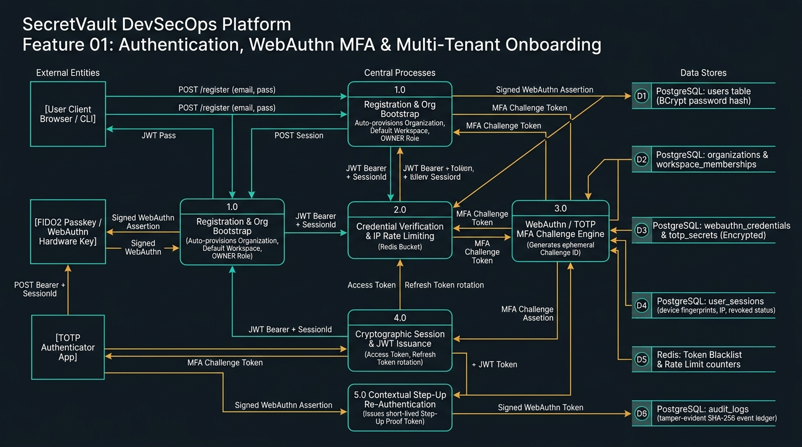
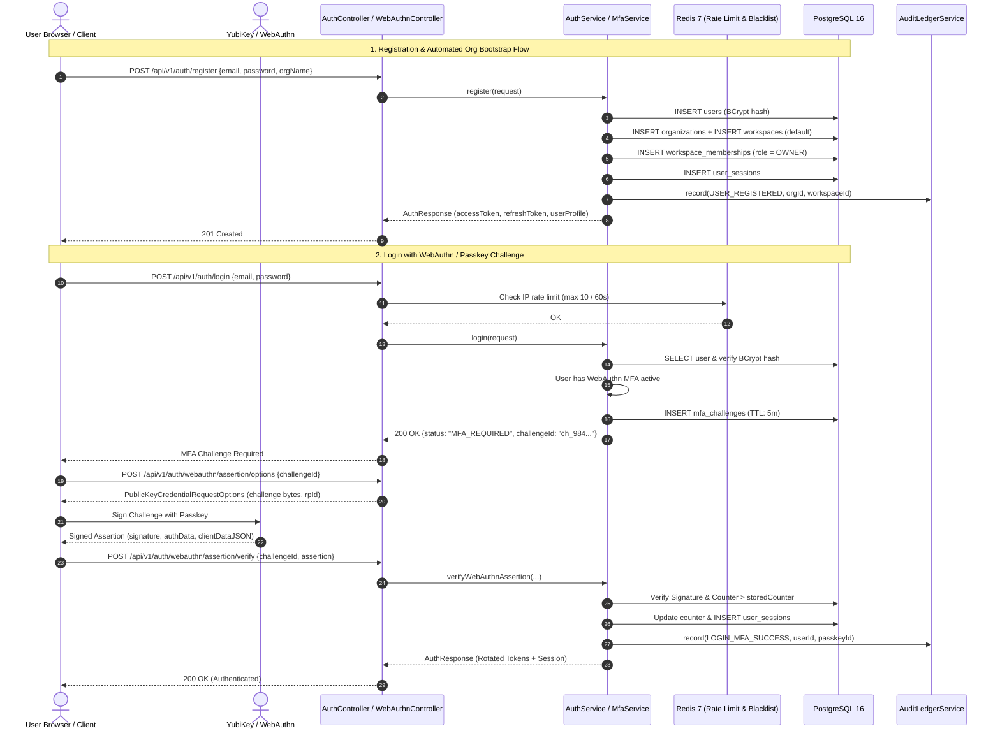

# Feature 01: Authentication, WebAuthn MFA & Multi-Tenant Onboarding — Data Flow Architecture

> **Feature 01** serves as the security perimeter of SecretVault. It governs user registration, automated tenant bootstrapping, credential verification with Redis IP rate-limiting, FIDO2/WebAuthn hardware passkeys, TOTP two-factor authentication, cryptographic session binding, and contextual step-up challenges.

---

## 1. Feature 01 Data Flow Diagram (DFD Level 1/2)

The diagram below details the data flow between external actors, processes, and persistence stores:

---

## 2. Process & Entity Architecture

### A. External Entities
- **[E1] User Client (Browser / SecretVault CLI):** Submits credentials, registration payloads, and handles session token storage in secure HTTP-only / memory contexts.
- **[E2] FIDO2 Passkey / WebAuthn Hardware Authenticator (YubiKey / Touch ID):** Performs public-key cryptographic sign operations with attestation and assertion counters.
- **[E3] TOTP Authenticator (Google Authenticator / 1Password):** Generates RFC-6238 time-based 6-digit one-time passwords from shared HMAC-SHA1 secrets.

### B. Core Processes
1. **1.0 Registration & Org Bootstrap:**
   - Validates password complexity and normalizes email.
   - Hashes password using BCrypt ($2a$, cost factor 12).
   - Atomic transaction creates `User`, default `Organization`, default `Workspace`, and assigns caller as `WorkspaceMembership(role = OWNER)`.
2. **2.0 Credential Verification & IP Rate Limiting:**
   - Checks Redis sliding window rate limits (10 attempts / 60 seconds per IP).
   - Verifies BCrypt password hash.
   - If MFA enabled, short-circuits to Process 3.0 by emitting `MFA_REQUIRED` with an ephemeral `challengeId`.
3. **3.0 WebAuthn / TOTP Challenge Engine:**
   - Evaluates challenge expiration (TTL: 300s).
   - Verifies TOTP time window ($\pm 1$ step) or verifies WebAuthn clientDataJSON, authenticatorData, signature, and checks replay counter.
4. **4.0 Cryptographic Session & JWT Issuance:**
   - Generates cryptographically secure session record with client device fingerprint, IP, and User-Agent.
   - Issues short-lived Access Token (15 min) with claims: `sub`, `sessionId`, `orgId`, `workspaceId`, `role`.
   - Issues Refresh Token (30 days) stored with SHA-256 hash in database.
5. **5.0 Contextual Step-Up Re-Authentication:**
   - Enforces re-verification prior to high-risk actions (e.g. secret reveal, environment purge).
   - Issues short-lived (5 min), single-use `stepUpProofToken` with `Cache-Control: no-store`.

### C. Data Stores
- **(D1) PostgreSQL: `users`:** `id`, `email`, `password_hash`, `status`, `created_at`.
- **(D2) PostgreSQL: `organizations`, `workspaces`, `workspace_memberships`:** Multi-tenant hierarchy containers and RBAC role assignments.
- **(D3) PostgreSQL: `webauthn_credentials` & `totp_secrets`:** Credential IDs, public keys, signature counters, and AES-256-GCM encrypted TOTP seeds.
- **(D4) PostgreSQL: `user_sessions`:** `session_id`, `user_id`, `ip_address`, `user_agent`, `device_fingerprint`, `is_revoked`.
- **(D5) Redis: Token Blacklist & Rate Limiters:** In-memory distributed TTL keys for revoked JWTs and IP bucket limiters.
- **(D6) PostgreSQL: `audit_logs`:** Append-only ledger recording `USER_REGISTERED`, `LOGIN_SUCCESS`, `MFA_CHALLENGE_ISSUED`, `MFA_VERIFIED`, and `STEP_UP_VERIFIED`.

---

## 3. End-to-End Sequence Interactions

---

## 4. Security & Invariant Checklist for Feature 01

- [x] **Rate Limiting:** Redis distributed sliding-window counter prevents brute-force attacks against `/login` and `/refresh`.
- [x] **Timing Attack Resilience:** Password checks execute constant-time comparisons.
- [x] **Replay Protection:** WebAuthn assertion signature validation enforces strictly increasing sign counters; TOTP rejects replayed tokens within the valid step window.
- [x] **Session Revocation:** Remote logout and security events instantly push `sessionId` to the Redis token blacklist.
- [x] **Step-Up Guardrails:** Sensitive endpoints require a step-up challenge verified within the last 300 seconds.
