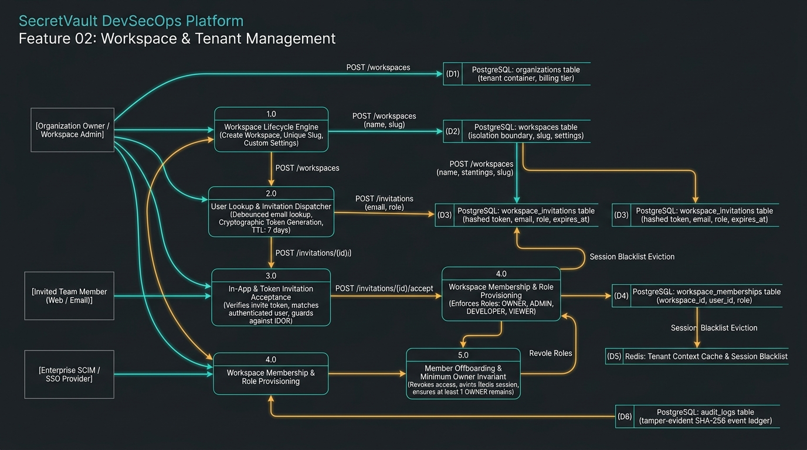
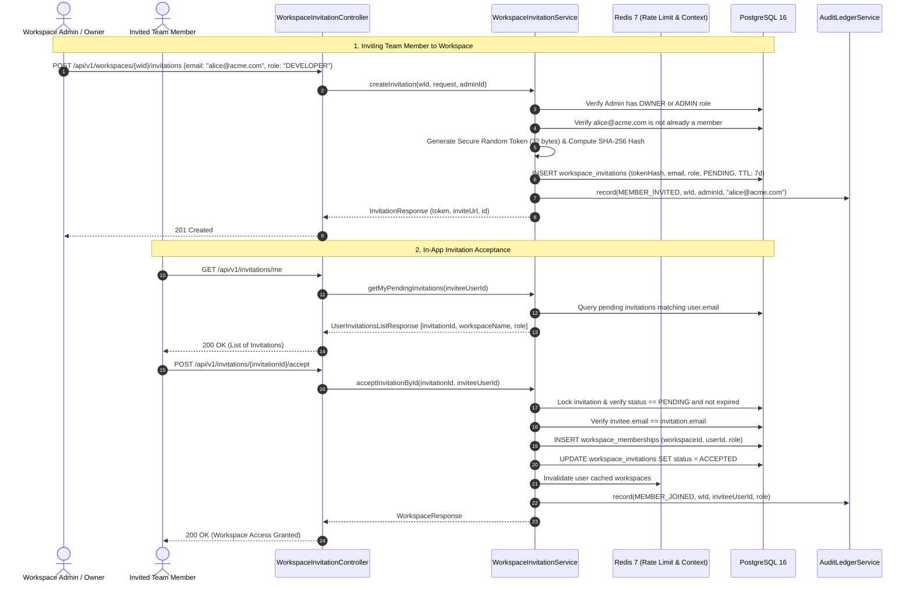

# Feature 02: Workspace & Tenant Management — Data Flow Architecture

> **Feature 02** establishes the authoritative isolation boundary of SecretVault. It governs organizational multi-tenancy, workspace lifecycle, debounced user lookup, cryptographically secure invitation tokens, in-app delivery, RBAC role assignment, and safe member offboarding with minimum-owner preservation invariants.

---

## 1. Feature 02 Data Flow Diagram (DFD Level 1/2)

The diagram below visualizes the flow of data across tenant boundary entities, processes, and persistence stores:

---

## 2. Process & Entity Architecture

### A. External Entities
- **[E1] Organization Owner / Workspace Admin:** Initiates workspace creation, updates security settings, invites new members, updates roles, or revokes memberships.
- **[E2] Invited Team Member (Web / Email):** Receives email invitation link or reviews in-app pending invites via `/api/v1/invitations/me` and accepts/declines access.
- **[E3] Enterprise SCIM / SSO Provider:** Syncs users and directory groups, auto-provisioning members into tenant workspaces.

### B. Core Processes
1. **1.0 Workspace Lifecycle Engine:**
   - Enforces unique slug generation within the parent organization.
   - Bootstraps workspace security policy defaults (MFA requirements, IP allowlists).
   - Assigns creator as `OWNER` in `workspace_memberships`.
2. **2.0 User Lookup & Invitation Dispatcher:**
   - Debounced lookup checks if invitee email exists, if they already belong to the workspace, or have a pending invite.
   - Rate-limited via Redis (20 invitations / 60s per workspace).
   - Generates a 256-bit cryptographically secure invitation token, hashes it with SHA-256 for database storage, and sets a 7-day expiration (`expires_at`).
3. **3.0 In-App & Token Invitation Acceptance:**
   - Supports two flows:
     1. In-App direct acceptance via `/api/v1/invitations/{id}/accept` (authenticated session).
     2. Secret token acceptance via email link `/api/v1/workspaces/{id}/invitations/accept?token=...`.
   - Rejects mismatched identities: ensures authenticated user's email matches the invited email address (guards against invite link forwarding attacks).
4. **4.0 Workspace Membership & Role Provisioning:**
   - Creates `WorkspaceMembership` entry with designated `WorkspaceRole` (`OWNER`, `ADMIN`, `DEVELOPER`, `VIEWER`).
   - Updates user session active tenant context.
5. **5.0 Member Offboarding & Minimum Owner Invariant:**
   - Enforces the **Minimum Owner Rule:** Prevents removal or demotion of an `OWNER` if they are the sole owner of the workspace.
   - Immediately purges cached permissions and invalidates active JWT sessions in the Redis blacklist.

### C. Data Stores
- **(D1) PostgreSQL: `organizations`:** Root multi-tenant entity (`id`, `name`, `slug`, `billing_tier`, `created_at`).
- **(D2) PostgreSQL: `workspaces`:** Hard isolation boundary (`id`, `organization_id`, `name`, `slug`, `is_default`, `settings`).
- **(D3) PostgreSQL: `workspace_invitations`:** (`id`, `workspace_id`, `email`, `role`, `token_hash`, `status`, `expires_at`).
- **(D4) PostgreSQL: `workspace_memberships`:** (`workspace_id`, `user_id`, `role`, `joined_at`).
- **(D5) Redis: Tenant Context Cache & Session Blacklist:** Fast O(1) membership lookup and immediate revocation blacklist.
- **(D6) PostgreSQL: `audit_logs`:** Tamper-evident ledger recording `WORKSPACE_CREATED`, `MEMBER_INVITED`, `MEMBER_JOINED`, `ROLE_UPDATED`, and `MEMBER_REMOVED`.

---

## 3. End-to-End Sequence Interactions

---

## 4. Security & Invariant Checklist for Feature 02

- [x] **Cross-Tenant IDOR Prevention:** Every request verifies that `Project.workspaceId == workspaceId` and `caller` has active membership in that specific `workspaceId`.
- [x] **Email-Locked Token Acceptance:** An invitation token can only be accepted by an account possessing the matching email address.
- [x] **Sole Owner Invariant:** The system prevents the last remaining `OWNER` from demoting themselves or leaving the workspace without transferring ownership.
- [x] **Instant Revocation:** When a member is removed, their session identifier is pushed to Redis blacklist to immediately block subsequent API calls.
