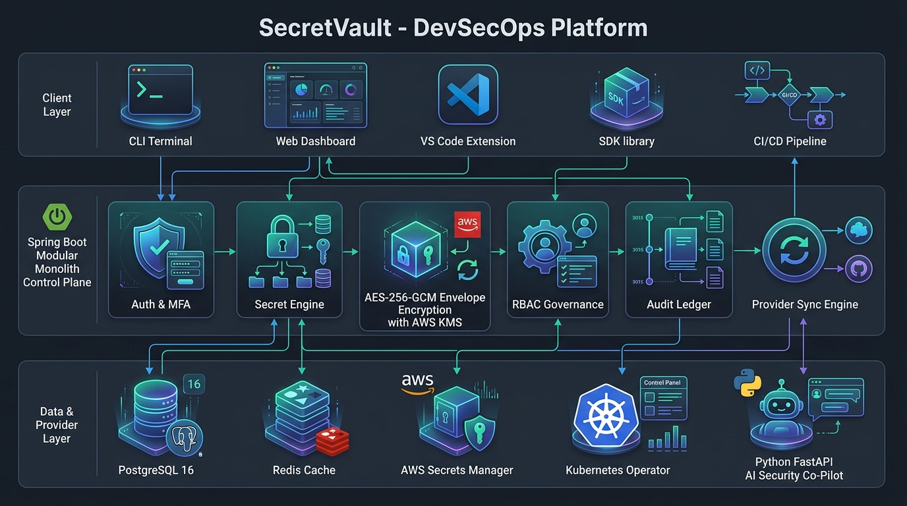
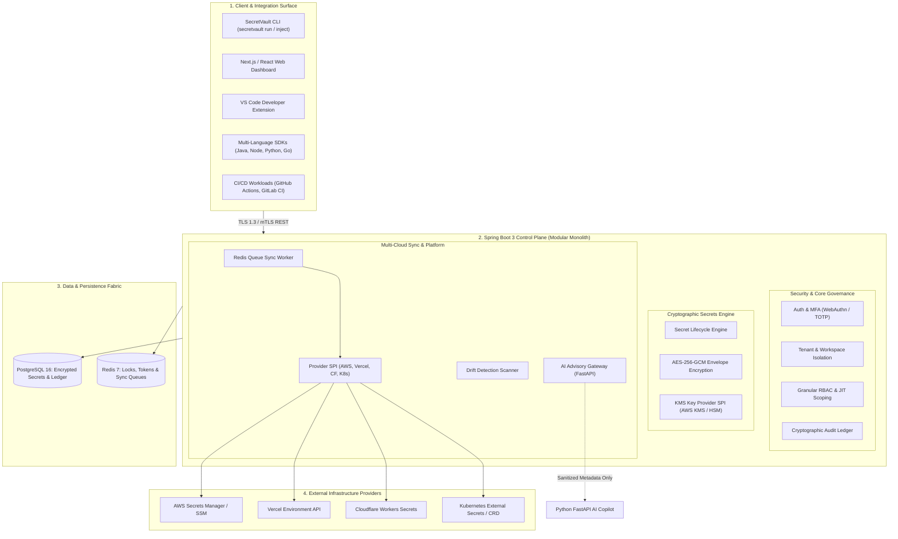
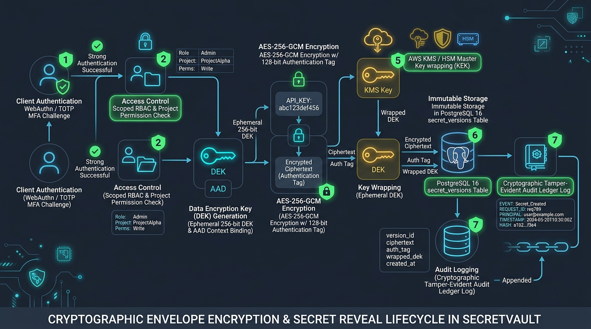
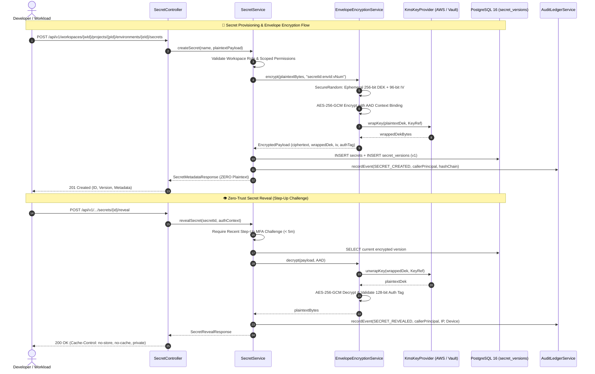
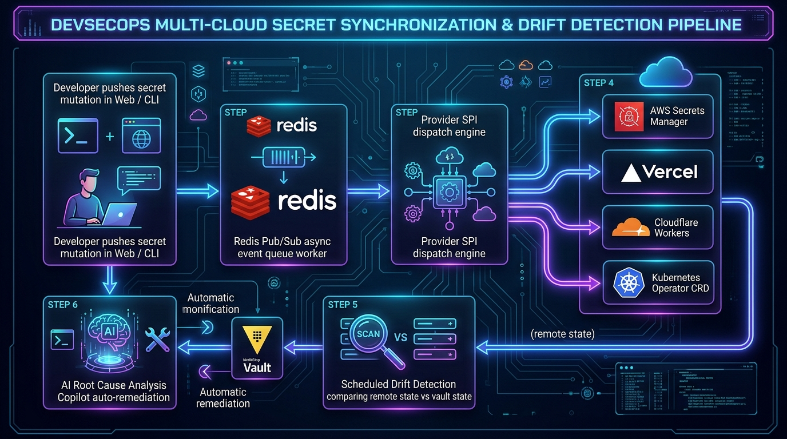
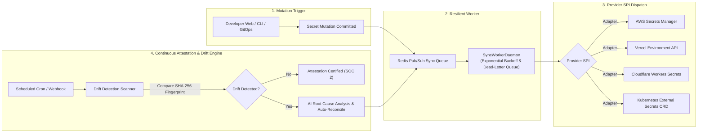

# SecretVault — End-to-End System & Workflow Architecture

> **SecretVault** is an enterprise-grade DevSecOps platform and Secrets Management control plane built as a **Spring Boot 3 (Java 21) Modular Monolith** with zero-trust envelope encryption, immutable audit chains, and automated multi-cloud synchronization.

---

## 1. High-Level System Architecture Topology

The diagram below visualizes the three-tier architectural layout: **Client & Developer Surface**, the **Spring Boot Control Plane (Modular Monolith)**, and the **Persistence & Cloud Provider Fabric**.

### Core Architectural Layers

---

## 2. Cryptographic Envelope Encryption & Secret Reveal Workflow

SecretVault implements zero-plaintext guarantees using authenticated hardware-grade envelope encryption (**AES-256-GCM**) with **Authenticated Additional Data (AAD)** context binding and pluggable Key Management Services (**AWS KMS / HSM**).

### Sequence Flow: Secret Ingestion vs. Decryption Reveal

---

## 3. Multi-Cloud Synchronization & Drift Detection Engine

SecretVault propagates secret mutations across cloud providers asynchronously via Redis queues and continuously reconciles discrepancies via autonomous drift scans.

### Synchronization & Auto-Remediation Pipeline

---

## 4. Multi-Tier Access Scoping & Zero-Trust Governance

SecretVault enforces strict tenant boundaries using an intersection formula to eliminate Privilege Escalation:

$$\text{Effective Permission} = \text{Workspace Role} \cap \text{Project Scope} \cap \text{Environment Scope} \cap \text{Security Guardrails}$$

| Access Tier | Container | Supported Roles / Grants | Security Invariants |
|---|---|---|---|
| **Organization** | Root Enterprise Tenant | Org Admin, Member | Billing, SSO, SCIM directories, global policy defaults |
| **Workspace** | Isolation Boundary | `OWNER`, `ADMIN`, `DEVELOPER`, `VIEWER` | Invitation tokens, member offboarding, baseline permissions |
| **Project** | Microservice Scope | `ProjectAccess` (Inherited or Constrained) | Restricts developer access to specific services only |
| **Environment** | Runtime Target | `READ`, `WRITE`, `MANAGE` | `is_protected = true` flags require JIT approval + MFA |

---

## 5. Authoritative Domain & Package Responsibilities

| Domain Package | Layer | Core Responsibilities | Key Classes & Services |
|---|---|---|---|
| `com.secretvault.auth` | Security | JWT authentication, WebAuthn FIDO2, TOTP MFA, step-up challenges | `AuthController`, `MfaService` |
| `com.secretvault.workspace` | Governance | Multi-tenant organization, workspace provisioning, SCIM membership | `WorkspaceService`, `MembershipRepository` |
| `com.secretvault.project` | Scoping | Application and microservice containers, scoped permission grants | `ProjectService`, `ProjectAccessRepository` |
| `com.secretvault.environment` | Runtime | Tier isolation (dev, staging, prod), protection policies | `EnvironmentService`, `EnvironmentProtectionRule` |
| `com.secretvault.encryption` | Cryptography | AES-256-GCM envelope encryption, DEK derivation, KMS/HSM integration | `EnvelopeEncryptionService`, `AwsKmsKeyProvider` |
| `com.secretvault.secret` | Secrets Core | CRUD, immutable version ledger, masking, diff engine, rollbacks | `SecretService`, `SecretVersionRepository` |
| `com.secretvault.provider` | Cloud SPI | Pluggable cloud adapters (AWS, Vercel, Cloudflare, Kubernetes) | `SecretProvider`, `AwsSecretsManagerProvider` |
| `com.secretvault.sync` | Pipelines | Redis-backed asynchronous synchronization workers, drift detection | `SyncQueueWorker`, `DriftDetectionService` |
| `com.secretvault.audit` | Compliance | SHA-256 tamper-evident hash-chained event ledger, SOC 2 exports | `AuditLedgerService`, `AuditLogRepository` |
| `com.secretvault.security` | Intel | Secret leak scanning, blast radius analysis, JIT approvals | `RiskCenterService`, `BlastRadiusGraph` |
| `com.secretvault.ai` | Intelligence | Outbound boundary to FastAPI AI Co-pilot (zero-plaintext) | `AiSecurityClient`, `AiCopilotService` |
