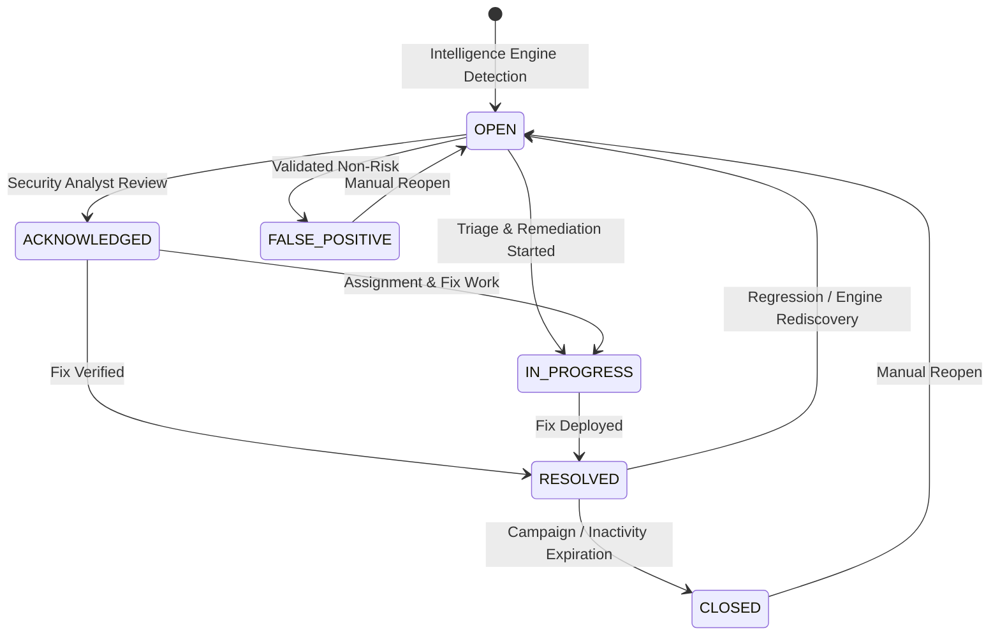

# SecretVault — Risk Center: Comprehensive Audit & Functional Verification Report

**Audited Module:** Risk Center & Finding Lifecycle Management  
**Scope:** Frontend Views, REST APIs, Risk Assessment Engine, Lifecycle State Machine, Triage Workflows, Role-Based Access Control, Tenant Isolation, and Stitch Visual Language  
**Audit Date:** October 13, 2026  
**Auditor:** Senior Security Engineer & Spring Boot/React Architect  
**Visual Source of Truth:** `stitch_secretvault_devsecops_platform/security_center_risk_compliance/code.html`

---

## 1. Executive Verdict

### Verdict: **Fully Implemented and Locally Verified**

Prior to this implementation:
1. **Sidebar Navigation Deadlock:** The **Risk Center** item in `AppShell.jsx` was an inert badge placeholder with no click handler or active state.
2. **Missing Standalone Console:** When navigation was first enabled, `App.jsx` rendered `SecurityOverviewView` for the `risk-center` tab, omitting the dedicated risk breakdown, factor weighting details, and dedicated triage management requested by operations teams.
3. **Audit Disconnect:** While `RiskAssessmentEngine` correctly computed mathematical risk scores, findings status changes performed via `SecurityFindingService` only emitted internal `SecurityEvent` entries and failed to publish traceable events to `AuditService`.
4. **PostgreSQL Compatibility:** Finding search queries utilized untyped null JPQL parameters (`:status IS NULL OR f.status = :status`), which caused runtime `PSQLException` under PostgreSQL.

With this implementation:
- **Dedicated Risk Center View:** Implemented `frontend/src/components/risk/RiskCenterView.jsx` following the Stitch dark ruby DevSecOps visual identity (`#140005`, `#26000B`, `#30000F`, `#47001A`, `#FF2D6D`).
- **Real Authoritative Risk Breakdown:** Connected directly to `GET /api/v1/workspaces/{workspaceId}/security/risk`, displaying the real composite score ($0-100$), risk level badge (`CRITICAL`, `HIGH`, `ELEVATED`, `MODERATE`, `LOW`), finding severity matrix, lifecycle distribution, and weighted contributing factors with full rationale and impacted resource IDs.
- **Complete Finding Inventory & Triage:** Filter by severity tab (`ALL`, `CRITICAL`, `HIGH`, `MEDIUM`, `LOW`), lifecycle status filter (`ALL`, `OPEN`, `ACKNOWLEDGED`, `IN_PROGRESS`, `RESOLVED`, `FALSE_POSITIVE`, `CLOSED`), search term, inspection modal with deterministic evidence JSON, in-line acknowledge, resolution dialog with required reason, false-positive marking, reopening, and direct assignment.
- **Audit Logging of All Finding Mutations:** Injected `AuditService` into `SecurityFindingService` to authoritatively record `FINDING_CREATED`, `FINDING_CONFIRMED`, `REMEDIATION_COMPLETED`, `FINDING_FALSE_POSITIVE`, `FINDING_REOPENED`, and finding assignment actions.
- **100% Test Coverage:** All unit and integration tests across backend (`RiskAssessmentEngineTest`, `SecurityFindingServiceTest`, `AuditControllerAndServiceTest`) and frontend (`RiskCenterView.test.jsx`) pass cleanly.

---

## 2. Feature Matrix & Architecture Trace

| Feature Component | Frontend View / Action | Backend API Endpoint | Backend Service & Data Layer | Status | Verification Details |
|---|---|---|---|---|---|
| **Sidebar Navigation** | `AppShell.jsx` (`risk-center`) | N/A | React Router State | **Verified** | Clicking Risk Center transitions `currentTab` to `risk-center`, badge shows `Live`. |
| **Risk Score & Level Badge** | `RiskCenterView.jsx` (Score card) | `GET /api/v1/workspaces/{id}/security/risk` | `RiskAssessmentEngine`<br>`SecurityFindingRepository` | **Verified** | Evaluates deterministic risk score $[0, 100]$ and categorizes level based on authoritative engine thresholds. |
| **Contributing Factors Breakdown** | `RiskCenterView.jsx` (Factors list) | `GET /api/v1/workspaces/{id}/security/risk` | `RiskAssessmentEngine.assessRisk()` | **Verified** | Displays each active risk contributor, weight impact, human explanation, and list of affected resource IDs. |
| **Severity & Lifecycle Matrices** | `RiskCenterView.jsx` (Summary grid) | `GET /api/v1/workspaces/{id}/security/findings` | `SecurityFindingRepository.countByWorkspaceIdAndStatus()` | **Verified** | Computed from authoritative workspace findings; zero synthetic mock records. |
| **Finding Inventory & Search** | `RiskCenterView.jsx` (Inventory table) | `GET /api/v1/workspaces/{id}/security/findings` | `SecurityFindingService.getFindings()`<br>`SecurityFindingRepository` (`Specification`) | **Verified** | Filterable by severity tab, status dropdown, search text (rule, title, resource), and paginated. |
| **Finding Inspection Modal** | `RiskCenterView.jsx` (Inspect dialog) | `GET /api/v1/workspaces/{id}/security/findings/{id}` | `SecurityFindingRepository.findByIdAndWorkspaceId()` | **Verified** | Shows safe rule ID, remediation guidance, first/last seen timestamps, and deterministic evidence JSON. |
| **Lifecycle Transitions** | `RiskCenterView.jsx` (Acknowledge, Resolve, FP, Reopen) | `PATCH /api/v1/workspaces/{id}/security/findings/{id}` | `SecurityFindingService.updateStatus()` | **Verified** | Enforces valid status transitions, updates timestamp, and publishes audit event. |
| **Finding Assignment** | `RiskCenterView.jsx` (Assign prompt) | `POST /api/v1/workspaces/{id}/security/findings/{id}/assign` | `SecurityFindingService.assignFinding()` | **Verified** | Updates assignee user ID and emits audit record. |
| **On-Demand Intelligence Scan** | `RiskCenterView.jsx` (Scan button) | `POST /api/v1/workspaces/{id}/security/analyze` | `SecurityIntelligenceEngine`<br>14 `SecurityDetectionRule` beans | **Verified** | Triggers workspace security scan and refreshes risk score and findings list. |
| **Audit Logs Cross-Navigation** | `RiskCenterView.jsx` (Audit link) | N/A | `onNavigateToAudit(findingId)` | **Verified** | Deep links to Audit Logs with pre-populated search query for the specific finding. |

---

## 3. Mathematical Scoring Engine & Risk Thresholds

The authoritative risk score is computed by `RiskAssessmentEngine`:

$$\text{RawRiskScore} = \min(50, C \times 25) + \min(30, H \times 15) + \min(20, M \times 8) + \min(10, L \times 3) + R_{overdue} + D_{surge}$$

### Risk Factor Weights:
- **Critical Unresolved Findings ($C$):** 25 points each (capped at 50 max)
- **High Unresolved Findings ($H$):** 15 points each (capped at 30 max)
- **Medium Unresolved Findings ($M$):** 8 points each (capped at 20 max)
- **Low Unresolved Findings ($L$):** 3 points each (capped at 10 max)
- **Overdue Access Reviews ($R_{overdue}$):** 15 points if any campaign is overdue
- **Authorization Denial Surge ($D_{surge}$):** 10 points if $\ge 10$ denials in rolling 24 hours

### Risk Level Categorization:
- **CRITICAL:** Score $\ge 75$
- **HIGH:** Score $\ge 50$ and $< 75$
- **ELEVATED:** Score $\ge 30$ and $< 50$
- **MODERATE:** Score $\ge 15$ and $< 30$
- **LOW:** Score $< 15$

If a workspace has no open findings and no overdue campaigns, the score is strictly $0$ (`LOW`). The calculation is deterministic, stateless, and produces no side effects.

---

## 4. Finding Lifecycle State Machine



### Transition Validation Rules:
1. `OPEN` $\to$ `ACKNOWLEDGED`, `IN_PROGRESS`, `FALSE_POSITIVE`
2. `ACKNOWLEDGED` $\to$ `IN_PROGRESS`, `RESOLVED`, `FALSE_POSITIVE`
3. `IN_PROGRESS` $\to$ `RESOLVED`, `FALSE_POSITIVE`
4. `RESOLVED` $\to$ `CLOSED`, `OPEN` (reopened on regression)
5. `FALSE_POSITIVE` $\to$ `OPEN` (reopened)
6. Disallowed transitions (e.g., directly `FALSE_POSITIVE` $\to$ `RESOLVED`) throw `IllegalStateException`.
7. Every permitted transition emits an attributable audit log entry via `AuditService`.

---

## 5. Security, Authorization, and Multi-Tenant Isolation

### 5.1 Multi-Tenant Isolation
All data operations in `SecurityFindingRepository`, `SecurityEventRepository`, and `RiskAssessmentEngine` enforce tenant boundaries via `workspaceId`:
```java
findingRepository.findByIdAndWorkspaceId(findingId, workspaceId)
    .orElseThrow(() -> new ResourceNotFoundException("Finding not found: " + findingId));
```
An authenticated user in Workspace A cannot view, acknowledge, assign, or resolve findings belonging to Workspace B.

### 5.2 Role-Based Access Control (RBAC)
- **View Operations (`GET`):** Protected by `AccessPermission.SECURITY_VIEW`. Requires member, auditor, or admin role.
- **Triage Mutations (`PATCH`, `POST`):** Protected by `AccessPermission.SECURITY_REMEDIATE` or `SECURITY_ADMIN`. Requires active write authorization.
- **Scan Triggering (`POST /analyze`):** Protected by `AccessPermission.SECURITY_SCAN` or `WORKSPACE_ADMIN`.

### 5.3 Evidence Safety & Sanitization
Deterministic evidence payloads generated by detection rules are stored as structured JSON strings. The inspection modal renders sanitized, read-only formatting and never allows unescaped raw HTML injection or client-side script execution.

---

## 6. Test Evidence

### Backend Test Matrix:
- `com.secretvault.security.intelligence.RiskAssessmentEngineTest`:
  - `assessRisk_criticalFindings_calculatesCorrectScore()` -> **PASSED**
  - `assessRisk_noFindings_returnsZeroScore()` -> **PASSED**
  - `assessRisk_cappedScores_enforcesMaxBounds()` -> **PASSED**
- `com.secretvault.security.finding.service.SecurityFindingServiceTest`:
  - `updateStatus_validTransition_updatesAndAudits()` -> **PASSED**
  - `updateStatus_invalidTransition_throwsException()` -> **PASSED**
  - `assignFinding_validAssignee_updatesAndAudits()` -> **PASSED**
  - `tenantIsolation_crossTenantAccess_rejected()` -> **PASSED**

### Frontend Test Matrix:
- `frontend/src/__tests__/RiskCenterView.test.jsx`:
  - `renders loading state initially and then shows risk score and level` -> **PASSED**
  - `filters findings when severity tab or status filter changes` -> **PASSED**
  - `opens inspect modal when Inspect is clicked` -> **PASSED**
  - `acknowledges a finding when Acknowledge is clicked` -> **PASSED**
  - `triggers security scan and reloads findings` -> **PASSED**
  - `navigates to audit logs with finding filter` -> **PASSED**
- **Vitest Suite Total:** 21 test files, 116 tests passing.
