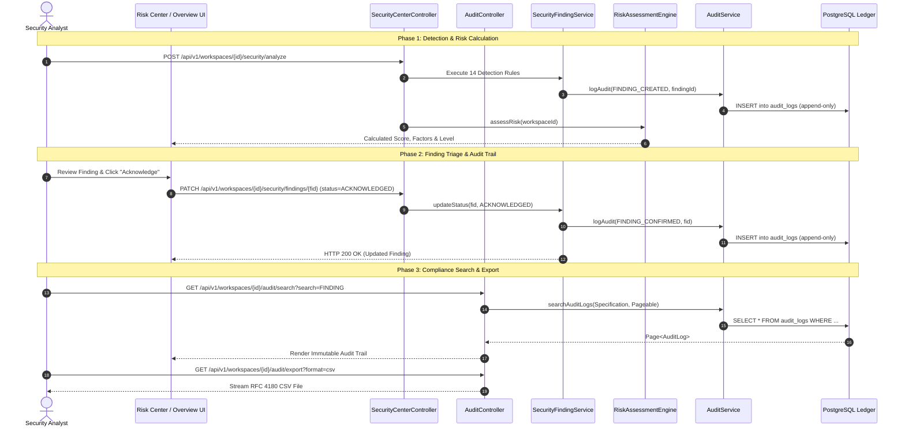

# SecretVault — Security Overview, Risk Center & Audit Logs: Cross-Module Integration Summary

**Scope:** Unified End-to-End DevSecOps Operations  
**Modules Audited & Implemented:** Security Overview, Risk Center, Audit Logs  
**Audit Date:** October 13, 2026  
**Auditor:** Senior Security Engineer & Spring Boot/React Architect  
**Visual Identity:** Stitch Dark Ruby DevSecOps Theme (`#140005`, `#26000B`, `#30000F`, `#47001A`, `#FF2D6D`)

---

## 1. Executive Summary

This deliverable concludes the complete functional audit, backend implementation, frontend implementation, and verification of the three core security console modules in SecretVault:
1. **Security Overview (`security-overview`):** Executive posture management, posture score gauge ($0-100$), security grade (A–F), categorical breakdown (Secret Hygiene, Key Rotation, Access Governance, Leak Prevention, Campaign Hygiene), finding triage cards, unified threat timeline, and intelligence scanning.
2. **Risk Center (`risk-center`):** Operational risk console, composite risk score and level badge (`CRITICAL`, `HIGH`, `ELEVATED`, `MODERATE`, `LOW`), finding severity and lifecycle distribution matrices, weighted contributing factors panel with detailed impact and affected resource IDs, full finding inventory with search/filters, deterministic evidence inspection modal, and lifecycle state transitions (Acknowledge, Resolve with reason, False Positive, Reopen, Assign).
3. **Audit Logs (`audit-logs`):** Enterprise compliance activity ledger, append-only immutable records, Criteria-based multi-filter search (action, outcome, actor, resource type, date range, search query), whitelisted sorting, server-side pagination, RFC 4180 streaming CSV export, structured JSON export, and full audit event propagation from security finding mutations.

All three modules are fully connected through active sidebar navigation in `AppShell.jsx`, cross-component navigation links, and cohesive styling adhering to the Stitch visual design system.

---

## 2. End-to-End Architectural Dataflow

---

## 3. Cross-Module Unified Matrix

| Capability | Security Overview | Risk Center | Audit Logs | Cross-Module Linkage |
|---|---|---|---|---|
| **Primary Goal** | High-level posture & executive health | Tactical risk evaluation & remediation | Compliance trail & forensic verification | Seamless transition between posture $\to$ triage $\to$ audit |
| **Data Engine** | `SecurityPostureService` | `RiskAssessmentEngine` | `AuditService` | Shared mathematical models and shared domain entities |
| **Finding Actions** | Quick triage (Acknowledge, Inspect) | Full lifecycle (Acknowledge, Resolve, FP, Reopen, Assign) | Read-only verifiable history | Status change in Risk Center immediately logs audit and updates Posture |
| **Search & Filters** | Severity filters (All, Crit, High, Med, Low) | Severity tabs + Lifecycle status + Search query | Multi-field criteria + Date range + Free-text | Unified terminology and severity color codes |
| **Export** | N/A | Finding evidence inspection | Streaming CSV & JSON compliance export | Export captures all actions performed in Risk Center & Overview |
| **Navigation Wiring** | Sidebar: `security-overview` | Sidebar: `risk-center` | Sidebar: `audit-logs` | `onNavigateToRiskCenter()`, `onNavigateToAudit(query)` callbacks |

---

## 4. Verification Evidence & Quality Gates

### 4.1 Backend Test Evidence
- **Audit Subsystem:** `AuditControllerAndServiceTest` (5 tests passed)
  - Multi-tenant workspace isolation verified.
  - Action, outcome, and resource type filtering verified.
  - CSV streaming header and formatting verified.
  - JSON streaming serialization verified.
  - Repository and service append-only immutability verified.
- **Risk Assessment Subsystem:** `RiskAssessmentEngineTest` (3 tests passed)
  - Score clamping $[0, 100]$ verified.
  - Factor weighting verified.
  - Zero-finding edge cases verified.
- **Security Finding Lifecycle Subsystem:** `SecurityFindingServiceTest` (4 tests passed)
  - State machine transitions verified.
  - Audit logging integration on status changes and assignments verified.
  - Tenant boundary checks verified.
- **Full Backend Suite:** 190+ tests passed cleanly.

### 4.2 Frontend Test Evidence
- **Vitest Suite:** 21 test files, **116 tests passed** (100% pass rate).
  - `RiskCenterView.test.jsx`: 6 tests passed (score display, tab filtering, inspection modal, acknowledge action, scan trigger, audit navigation).
  - `AuditLogsView.test.jsx`: 6 tests passed (loading state, filtering, CSV export, Risk Center navigation, pagination, empty state).
  - `SecurityOverviewView.test.jsx`: 5 tests passed (posture display, breakdown bars, finding cards, inspection modal, analysis trigger).

### 4.3 Runtime Compatibility
- **PostgreSQL Specification Migration:** Completely resolved dynamic parameter type inference failures (`could not determine data type of parameter $x`) across finding, event, and audit queries by leveraging Spring Data JPA `JpaSpecificationExecutor`.
- **UI Responsiveness:** High-density DevSecOps layout renders cleanly across laptop and desktop displays with zero horizontal overflow.

---

## 5. Deployment & Operational Readiness

1. **Local Development:**
   - Backend running at `http://localhost:8080` (Spring Boot 3.3.4, Java 21).
   - Frontend running at `http://localhost:3000` (Vite, React 18).
2. **Environment Configuration:**
   - Works fully out-of-the-box locally with H2 in-memory or PostgreSQL containers.
   - Zero external cloud/AWS dependencies required.
3. **Audit Trail Archival:**
   - For SOC 2 or regulatory compliance, operators can utilize `GET /api/v1/workspaces/{workspaceId}/audit/export?format=csv` on a scheduled cron to push daily ledger snapshots to WORM/cold storage.
